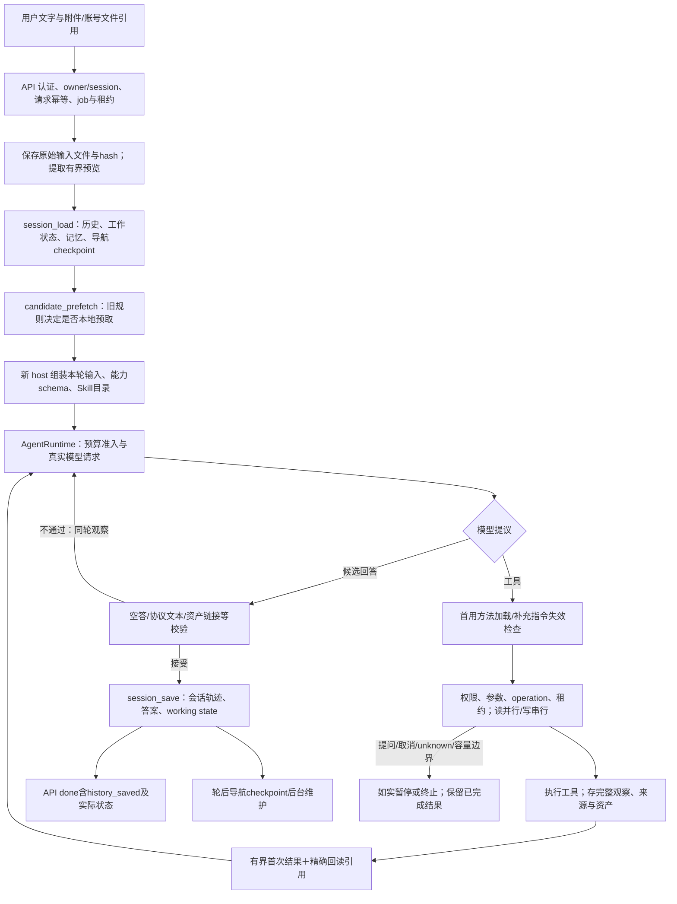
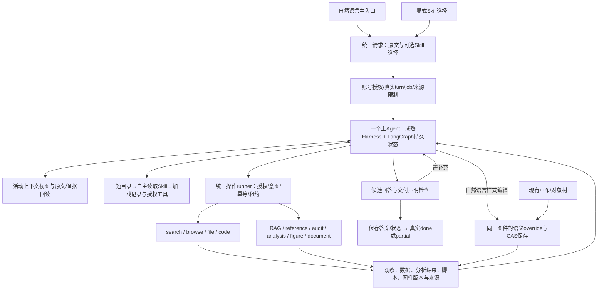

# CitrusScholar：当前源码审计与完整改造计划

> 2026-11-15 完整修订稿。依据用户桌面原计划整合更新，未覆盖原文件。
> 已完成的基线与 P1–P4 工作继续保留；此次执行覆盖剩余 P5、P6、P7、P8，全部实现后统一测试。原源码审计章节保留其时间背景；当前状态以迁移证据和实际源码为准。
> 主架构始终是一个 Agent Loop：用户目标 → 按需方法 → 受控工具 → 真实观察 → 修正/继续 → 持久答案。四场景为科研检索、文献核验、数据审查、科研绘图；图件编辑属于工作台。

## Context

产品目标：完整 General Agent（search、browse、code、file），叠加领域资料 RAG 和可组合科研 Skills。**自然语言是主入口：主 Agent 从简短能力目录自主发现并按需加载 Skill；“＋”是可选的显式选择入口；斜杠命令留作以后快捷方式，不纳入当前验收。**预设提供方法、确定性计算与质量要求，不接管主循环，不增加独立 LLM 分类器，也不把 coding 降为失败后的兜底。

**第一阶段产品闭环：自然语言任务 → 读取/理解/必要清洗数据 → Python + 固定 Nature Skill 绘图 → 实际审核 → 同一 Agent 自主修复 → 用户自然语言或画布编辑 → 保存当前图件与真实导出 → 跨轮继续。**绘图生成能力开放，前端可视化拾取对象适度收敛。通用执行、上下文和持久恢复是基础；文献与数值审查的既定补缺继续保留。Origin、完整 Excel 式编辑平台、完整 R/ggplot2 后端、任意 SVG 编辑器、每图型配置面板、完整独立绘图平台及强制子代理均不作为第一阶段依赖。

本计划依据 2026-11-15 当前工作树重新组织，取代旧计划中“验收全部通过才允许基线提交”“科研场景决定通用工具可用性”“固定覆盖/停滞计数驱动结束”等假设。当前实现已有真实改善，不能把旧问题全部当作仍然存在。

**当前执行边界（2026-11-15 用户最新修订）：**接续既有 P0–P4，完成 P5、P6、P7 和 P8 的源码接线、收敛与清理，再统一运行必要测试和回归。开发期间仅做必要静态检查，不反复运行真实供应商、容器和浏览器验收。用户自行启动服务并实测多轮，随后按真实日志定位。部署、提交、推送不自动执行。图件历史版本和恢复功能取消，保留原始脚本、必要数据、当前修改与当前导出；Agent Loop 的任务检查点、对话和操作回执不受此调整影响。

源码根：`E:/codex_WORKSPACES/CitrusQA_Local/.claude/worktrees/research-workspace`；下文文件路径相对此根。命令继续从 `_scratch/local_service_c37f40a` 执行。审计为关键调用链和专项实现的静态阅读；不声称逐行审计了整个仓库。此前 557 项组合回归通过、1 条已有 Matplotlib 警告，只证明其覆盖的离线契约，不代表真实模型、运行服务或完整科研验收。

## 1. 版本留存与运行证据

| 项目 | 已核实事实 | 待做事项 |
|---|---|---|
| 仓库/分支 | `https://github.com/w1-23/QAagent`；`feat/research-workspace` | 只纳入产品本体相关代码、依赖、必要测试和产品文档 |
| 已留存基线 | `a888779e17eea04ec57525fa2f7c02d53841726b`；`refs/heads/baseline/research-workspace-20261115` | 当前后续修改尚未提交；不重复 P0，不以旧授权自动提交后续代码 |
| 远端状态 | 此轮不以本地引用推断线上源码 | README 先更新本地，未获推送授权不声称 GitHub 已同步 |
| 当前改动 | 新 agent 包及 core/graph/research/figures/session/tools/API/UI 等已有改动；三个旧控制模块已获准删除 | 基线保存现状，保留“未完整验收”标记，不先夹带新改造 |
| 忽略规则 | `.gitignore` 默认忽略 `test_*.py`，存在必要的新回归测试未被普通 add 纳入 | 逐项审查依赖和测试；不能整目录强制 add，旧测试/生成物/重复 vendor 不自动纳入 |
| 工程材料 | `engineering/product_evolution` 等也有变动 | 按产品必要性分类；实验、专利、外部 harness、gold/scorer、临时材料不入库且不删除 |
| 当前可见服务 | preview 中 8010 的 cwd 为原始 `CitrusQA_Local` | 不能证明工作树代码已部署；不得停止该实例 |
| 部署身份 | 此轮未核实运行 commit、worker image digest、前端资源构建 hash | 发布前分别记录，未知就写未知 |
| 本地依赖 | langchain-core 1.4.8、langchain-openai 1.3.2、langgraph 1.2.6、openai 2.43.0、pydantic 2.12.4；deepagents/pydantic-ai 未安装 | 安装状态不等于锁文件可重现；兼容验证使用隔离依赖环境 |

P0 留存动作：复核状态和暂存区 → 列出产品文件及必要被忽略测试 → 检查暂存差异与秘密排除 → 创建当前分支基线提交 → 创建指向该提交的本地 `baseline/research-workspace-20261115` 引用（若重名，用唯一后缀，不移动已有引用）→ 记录真实 SHA、文件清单、依赖/运行证据和未验证范围。提交说明末尾使用规定 Co-Authored-By。该次基线留存授权已执行；后续代码提交和远端推送不自动沿用该次授权。

回滚分三层：源码通过新分支/隔离检出指定 baseline 复现，不对当前工作树执行 hard reset；运行实例恢复此前明确标识的镜像/资源；数据迁移另有一致性备份及向后兼容策略。Git 快照不包含账号数据库、用户文件和运行数据，不能当作完整服务备份。恢复前先对账未决写操作，不把旧代码直接接到未知新 schema 数据库。

## 2. 从用户提问到输出：迁移前审计与留存

本节保留原计划制定时的调用链审计，行号和旧问题用于说明迁移依据，不代表当前接线。当前主链为 `session_load → supervisor（公开 create_agent / LangGraph）→ session_save`，按需 Skill，不再默认执行 candidate_prefetch；实际阶段证据见 `agent_migration_evidence.md`。

图中描述的是当前源码，不是当前 8010 的已验证运行行为。

| 阶段与关键实现 | 输入、处理与输出 | 留存和边界 |
|---|---|---|
| API 入场 `api/main.py:1450`、`:1583` | 账号/会话、幂等、job、用户输入、附件引用；原始上传在流式处理前私有保存 | owner/file ID/hash 是资产身份；不靠模型生成文件路径。DOCX/PDF文本等有提取范围和预览限制 |
| 初始状态 `main.py:1697` | request/turn/session/user 与截止时间；`agent_no_prefetch_hints=True` | **主聊天入口已关闭旧 hints 模型调用**。不能因 `_generate_hints` 函数存在就断言每轮仍调用理解模型 |
| 装载 `graph/session_nodes.py:15`、`core/context_manager.py` | 原始历史→发送投影；working state、引用、记忆、checkpoint | 历史装载失败有降级状态；不能把降级当作历史完整。导航摘要不是执行恢复检查点 |
| 预取 `graph/candidate_prefetch.py:142` | 仍用旧 `source_scope(query)`、约束与语料族匹配；可能翻译后一次本地混合检索 | 候选正文驻请求内存，初始只给数量/族；精读后才成为证据。其旧 scope 与新 host 排他限制口径不一致；尚非默认 local+web 共同发现 |
| 宿主 `agent/host.py`、`host_policy.py` | 恢复引用，主模型，允许的能力，Skill目录，本轮真实输入 | 目录固定25项；可见性依就绪/授权变化。科研主题不应禁用通用能力 |
| 循环 `agent/runtime.py`、`model.py` | 模型→工具→观察；拒绝截断、未知finish和非法call ID；终答校验失败回同一循环 | 模型步不是用户轮；取消覆盖await；恢复继承步数。**checkpoint回调当前只存进程变量**，服务重启不可据此原样接续 |
| 派发 `agent/execution.py`、`host_tools.py`、`tools/registry.py` | 真实job/owner/session/request校验；操作意图、租约、执行与结果；读并行上限4、写串行、用户交互屏障 | 缺持久operation不直接调用；真正执行前才标dispatched；已执行未知写保持unknown并停止后续动作，禁止盲重试 |
| 结果 `core/tool_results.py`、`graph/agent_operations.py` | 完整结果/元数据保存成功后，才发有界首次观察；`read_tool_result`精确分页回读 | 存储失败停止。未固定结果存在保留/轮转策略（当前每会话800个未pin结果），工作引用需pin传递依赖 |
| 最终答案 `host.py` | 可直接回答；资产链接检查失败让模型继续；无独立无工具终答模型 | 当前终答校验不能证明整个用户目标已完成；必须由真实任务/批次/资产回执支撑完成声明，不恢复旧科研覆盖计数器 |
| 保存 `graph/session_persistence.py:15` | 清理公开轨迹、保存单一答案和身份、工作状态；成功后调度轮后checkpoint | 会话保存、working state、后台证据/摘要不是一个跨库事务；API done虽在save节点后，仍可能携带`history_saved=false`警告，不能表述为done必然已持久化全部状态 |
| 下一轮与界面 | 会话记录、工作引用、导航摘要用于后续装载；SSE事件驱动实时进度 | 私有provider reasoning不进入公开历史。前端刷新、长历史分页、取消导航与live/history一致性需实测；文件存在不等于模型一定可发现 |

额外模型调用应按实际路径计量：主模型与其重试、需要时的检索翻译、轮前旧历史压缩兼容路径、轮后checkpoint。当前主API禁用hints；工具内部是否调用模型以实际receipt为准，不把全部请求统一写成固定若干模型调用。

## 3. 循环和四类状态：原审计与保留契约

| 状态 | 当前实现 | 目标契约 |
|---|---|---|
| Conversation history | session manager保存脱敏用户/assistant/tool轨迹与身份；用于UI及历史查找 | 稳定用户轮和消息ID、可分页/搜索/around；不因模型压缩删历史，不记录私有reasoning |
| Active model context | 稳定规则、历史投影、当前请求、Skill及本轮观察；当前轮内追加 | 可观察的发送视图；完整请求估算包含schema/图片/参数/输出预留；不能冒称是provider精确token数 |
| Task/run execution | jobs、operation、预算、事件持久；LoopCheckpoint仅进程内 | 成熟checkpointer承载可执行状态；真实身份、call/result配对、补充要求水位、剩余预算、未决操作、恢复策略均持久 |
| Assets/evidence | 上传、tool result、脚本、dataset、图件、审查结果等多个存储 | ID/version/hash/owner/来源链；全量证据可精确回读；生命周期与依赖固定；UI与模型用同一引用体系 |

已解决并保留：旧科研停滞/两批探索截断、独立终答循环；过早标记dispatched；unknown降级failed；异步工具artifact丢失；请求用户输入strict schema；历史query永久累积为约束；保存轨迹丢失operation/result引用等。三个旧模块已删除，不再计划重复删除。

仍需解决：进程重启恢复；补充指令`apply_updates`确认与checkpoint提交原子关系；固定候选预取；科学实现与通用接口耦合；通用工作区缺失；工具级脚本仍有“初次+两次修复”预算，不能误写为主循环已删除就全系统没有此限制。

**已批准的上下文政策：**原始历史和证据永不以摘要替代；默认首先用结构化回执、有界首交、精确回读及按需Skill降低占用。对于长任务，允许在同一真实用户轮、同一预算和授权下，透明生成“活动工作集导航摘要”；只有原文持久化并校验可读、没有未配对工具调用、待决写状态已固定时才能切换发送视图。摘要保留原请求/修改指令、未完成工作、关键数值/引文定位、错误和来源；摘要本身不作为科学事实依据。发生压缩要展示原因、前后估算和回读入口。压缩失败或无法安全保留provider协议状态则暂停，不静默丢证据、换run刷新预算、伪造用户轮或借子代理规避容量。保留显式“本轮不压缩”模式，达到真实边界如实暂停。

这是对旧“轮内一律不压缩”约束的已批准变更，当前接线与已验证范围以 P3 阶段证据为准。当前代码fallback配置：active输入128000、working最大64000/soft48000/target32000、累计模型调用64/累计tokens1000000；这些不是实际供应商窗口或生效的管理员覆盖值。实施时记录安全的有效配置和provider能力，不读取/输出秘密。

## 4. Skill、模型工具、后端函数：原清单与收敛

当前8个Skill：`candidate-search`、`reference-verification`、`data-audit`、`figure-initial`、`figure-edit`、`nature-figure`、`statistics`、`word-export`。来源为`src/prompts/skills/catalog.json`和`skill_registry.py`，校验包内路径/hash/固定来源；读取Skill只提供指导，不会凭文本导入Python或注册任意工具。

当前主入口先给目录；通过`research_workspace`读取Skill及资源；首用绘图/Word时host注入方法，原提案得到not_run后由模型修订。其他Skill主要由模型选择。**自然语言已接入；斜杠命令和“＋”Skill选择尚未实现。现有＋是附件选择/工作台导入。**

| 模型可见工具（25项全部列出） | 真正执行什么 | 收敛方向 |
|---|---|---|
| `request_user_input` | 保存结构化待回答问题、暂停，其他同批调用not_run | 保留统一交互入口 |
| `deepseek_search` | 配置搜索服务上的web发现 | 通用search后端；保留来源/查询回执 |
| `deepseek_fetch` | URL内容读取 | 通用browse/read；与论文获取共享下载/来源层 |
| `deepseek_fetch_paper` | 论文相关内容获取 | 作为browse的论文适配器，不强制所有网页走论文流程 |
| `local_hybrid_search` | 本地语料混合检索 | search的领域来源，保留授权/翻译失败状态 |
| `inspect_candidates` | 列举候选池元数据 | 候选集合服务，保留细粒度分页 |
| `search_candidates` | 在候选集合搜索 | 与上项共享集合身份/生命周期 |
| `read_candidate` | 读取候选正文并形成证据 | 与通用read共享引用格式，避免重复精读 |
| `draw_svg` | SVG清理/登记图示 | 通用图示；不能冒充Nature科研成图 |
| `read_account_file` | 按账号授权读已存文件/分页 | 统一文件读服务 |
| `read_tool_result` | 按引用读完整历史工具结果 | 统一证据回读，保留operation与页范围 |
| `research_workspace` | 目录/Skill读取、科研脚本/运行/数据引用操作 | 拆清capability发现与通用workspace；不是任意宿主shell |
| `inspect_uploaded_table` | 加载并预览表、列、sheet等 | 共享source/coordinate loader |
| `audit_uploaded_data` | 确定性表检查、跨文件复用、显式汇总对比；或手工标注支路 | 一套组合审查服务，人工标注不能冒充自动扫描 |
| `search_literature` | 多登记库书目发现与候选返回 | 文献服务的search操作 |
| `verify_uploaded_references` | 提取/接收条目，逐条查身份和部分元数据 | 文献服务的verify操作，聊天/PDF复用 |
| `fetch_and_audit_open_supplements` | 获取公开附件/解包/有限表格审查 | 下载后调用共享loader和audit，不维护第二套扫描器 |
| `word_document` | Word读取/生成等文档操作 | 通用document能力+Word Skill |
| `deliver_research_artifact` | 从已有数据/核验引用导出表格、书目、HTML等 | 通用export，尽量引用原始结果而非模型重抄 |
| `save_research_note` | 明确授权下写账号级笔记 | 独立于会话摘要；保留显式写权限 |
| `recall_research_notes` | 检索已存笔记 | 通用memory读取适配 |
| `analyze_research_data` | 确定性统计分析，SciPy/statsmodels等 | analysis服务，分布诊断不能默认算作audit已执行 |
| `audit_research_images` | 图像完整性相关审查入口 | 独立图像能力；不混同数值审查，本轮未深入逐条图像算法 |
| `create_research_figure` | 声明式六类图的受控渲染 | figure服务的spec renderer |
| `run_research_figure_script` | 隔离worker执行Python，可零图探索/表/多图输出 | 统一workspace执行与figure renderer适配；保留真实输出契约 |

模型工具是有schema、有权限、可记账的动作边界；`audit_frame`、`audit_numeric_reuse`、`compare_reported_summaries`、`audit_pdf`等是后端函数，不必各自变成一个模型工具。Skill规定何时组合这些动作和如何解释结果；模型负责选择映射、补充调查、解释，不代替确定性统计。

收敛优先消除重复实现和重复状态，不为了工具数少造一个接受任意字符串的巨型工具。内部统一source/data/reference/figure/export服务；外部按常用小工具与按需加载的类型化能力集发布，保留权限隔离与operation身份。旧工具名先保留兼容适配，迁移完成再清理。

### 目标：主 Agent 按需加载，方法与执行分别留证

- 初始提供 Skill 名称、短描述、版本及可信资源入口；主 Agent 根据当前任务读取需要的方法和资源，可以在同一循环组合数据审查、统计、Nature、图件编辑等 Skill。不每轮注入所有全文，不新增前置分类模型或科研场景路由器。
- “＋”显式选择把 Skill ID/版本写入请求，由宿主验证并实际加载对应方法；保留原始文字。不能只给提示词加一个名字。未显式选择时，自动发现必须同样工作；斜杠命令以后可复用这些字段，当前不实现。
- 分开记录 `discovered / partially_loaded / loaded / failed` 与方法所要求的实际执行回执。加载记录绑定真实 turn/run、Skill ID/version/hash、已读取资源与范围；必需正文/资源未读完不标 loaded。记录证明内容确实交付，不能证明模型理解或审核已执行。回答提到 Skill 名称不计作加载证据。
- 专用工具可以在对应 Skill 方法加载后动态公布；工具实现/schema仍由代码白名单和宿主权限控制，Skill 文本不得注册任意函数。调用前复核方法版本、资源完整性、授权与就绪状态；通用 search/browse/code/file 按原授权保持可用，不依赖科研主题分类。
- 重启或上下文投影后，从持久记录和原文恢复必要方法与资源，避免“曾加载”却在实际发送视图中丢失方法。旧版本不可用明确失败；禁止悄悄换成新版本。加载失败仅限制依赖该方法的质量承诺，不关闭无关通用能力。
- 优先适配 Deep Agents 已有目录、读取和工具披露机制（§8），复用本地 `skill_registry` 的来源/hash校验和 `research_workspace` 的读取入口；不另建一套 Skill 执行引擎。

## 5. 数值审查：原规则审计与 P6 补缺目标

正常链：工具schema → 受控operation runner → `research/tools.py`加载器 → `audit_methods.audit_frame`；两份以上不同附件另调用`integrity.audit_numeric_reuse`；显式raw/reported绑定另调用`summary_consistency.compare_reported_summaries`。主要依赖pandas/NumPy；精度及跨文件比对用Decimal/Fraction。SciPy分布检验在统计工具中，不在默认表审查里。

| 规则/实际函数区域 | 触发与计算 | 适用/输出/误报限制 |
|---|---|---|
| 空表、空列、必填缺列、缺失 `audit_methods.py:185` | 空表立即返回；局部缺失≥50%报列信号；非optional缺失逐cell；required缺失error | 空optional列可只给信息；optional不豁免其他规则；空白规范化在不同格式不完全一致 |
| 常量、混合类型、非数值、疑似表头 `:227` | 唯一非空值=1；可转数值与非空非数值混合；cell检查需非空≥5且数值占非空≥80%；首数据行在≥2此类列失败提示多行表头 | 不是严格dtype/枚举/日期校验；不是遍历整表检测重复表头；ID/分组常量可能合法 |
| 重复 `audit_duplicates/:97` | 每个声明key独立`duplicated(keep=False)`；整行全字段相等 | **不是复合键**；全行重复最多10000行；重复测量值不等于重复记录 |
| 分组IQR `audit_group_outliers/:113` | 声明value+实际group，整体≥8且数值/非空≥80%；每组n≥8；Q1/Q3，界外`Q1−1.5IQR`、`Q3+1.5IQR`；IQR≤0跳过 | 不自动退回无分组IQR；全局不足可没有专门提示；异常只提示复核；每partition最多10000离群 |
| 范围与逻辑 `:287` | 仅显式min/max（端点允许）；联合数值行上的<、≤、>、≥、== | 无领域自动正常值库；缺列跳过，未知operator目前默认OK；应改为invalid_config。冲突当前主要定位左cell |
| 列相同/固定差/固定比/线性 `:315` | ≥5数值且数值/全行≥80%；前30合格列两两组合；共同前20000位置；float比较；差容差`t=max(1e−9,1e−9×max(abs(a),abs(b),1))`；比spread≤`max(1e−8,1e−8×max(abs(ratio)))`；否则np.polyfit残差≤t | 列级信号；比检测排近零分母；大整数float丢精度/基线很大时容差过宽；换算、归一化、共享对照都可能合法 |
| 小数尾部集中 `:376` | 保留`abs(x−round(x,2))>1e−6`；n≥12、distinct≥8；格式化到六位小数后取末两字符，某尾数频率≥35% | **不是原始文本末位**，也不是显著性检验。三四位测量值补零可能自然集中；只返回列级信号 |
| 分组/重复数 `:388` | 显式分组总行数不等；映射replicate的非空唯一ID数不等 | 不平衡设计合法；无预期因子格、缺处理组合或实验单位核验；无group有skipped提示 |
| 整数均值/SD一致性 `summary_consistency.py:15` | 确认整数观测、mean/n映射、精度d；舍入区间`v±0.5×10^-d`；`n×均值区间`无整数则冲突；样本`Q=(n−1)s²+nμ²`、总体`Q=nσ²+nμ²`区间无整数则冲突 | Decimal精度60；n为1…10^9整数、d=0…12；样本SD需n≥2。仅必要条件，不能证明存在符合全部条件的原始样本 |
| 跨文件列复用 `integrity.py:248/:443` | Decimal→Fraction；默认≥5匹配行、≥3distinct、≥80%覆盖、相同行数；exact→offset→ratio→affine；容差`1e−10+1e−9×max(range实际,range预测)` | 按行序号对齐，不是sample ID；重排保持多重集及ties提示；不同单位/共享样本需要解释 |
| 跨文件块 `integrity.py:511` | 完整数值5×2种子向横纵扩展；重排为全高度连续2列窗口、共享行置换、完整行≥80% | 不做转置、任意子矩阵重排、非线性或任意子集搜索；不能称“所有可能复用均排除” |
| 跨文件小数尾对应 `integrity.py:337` | 无更强对齐关系时；双方≥4有效小数；共同p≤12；`floor(abs(x)×10^p) mod 1000`相等，末位非零；≥5对、≥80%、≥3distinct尾数 | 与上面的集中规则不同：这是三位后缀对应；无造假概率输出 |
| 原始值与报告汇总 `summary_consistency.py:98` | ≤50显式绑定；可选≤500原行ID；重算n/mean/样本SD/SE=SD/√n；n精确、其余按报告舍入区间 | 要确认实验单位/计量单位/SD约定；拒绝截断snapshot；定位双方source；不自动核正文/caption/p值 |
| 分布诊断（单独工具） `statistics_tools.py:126` | Shapiro–Wilk适用非恒定3≤n≤5000，默认p<.05；>5000描述skew/kurtosis；Levene需≥2有效组且每组≥2 | 由分析操作触发；不自动等于数据审查完成，正态性拒绝也不是不端证据 |

**明确未实现：**相邻一阶差分连续等差、滑动窗口等差、任意数值对差频率；原始末位频率/Benford/均匀数字检验；一般行内数值规律；严格dtype/枚举/日期；自动单位换算；公式重算；全局z-score/MAD异常。不能用“列间固定差”冒充“单列等差序列”。

加载与覆盖：主loader最多100000行/200列/2000000cells；Excel `data_only=True`不重算公式，缺缓存可能表现为缺失；PDF前200页、提取表最多500，无OCR全覆盖承诺。普通工作簿默认遍历发现的sheet，失败/空sheet应显示跳过；PDF/Word多表需明确选择。完整scan最多20000 findings；部分内层截断没有独立提示。跨文件工具实际snapshot仅500行×20物理列/表、≤20表、总100000cells，并限制600列对/4000窗口/200块候选/20 findings；不能拿库的更大默认值描述实际工具覆盖。

公开补充材料路径目前只取Excel首sheet/PDF前50页首表，跳过Word，Excel绕过共享bounded loader；空mapping使分组/范围等检查不执行。需统一加载器，并让每条规则返回`executed/skipped/invalid_input/truncated/failed`及实际样本/比较范围，不能预先把整个规则族标“已执行”。

输出：cell规则有原始row/column并在工作簿转A1；很多规则只有列/表级信号，不应承诺每个发现都能涂具体cell。跨文件已有双source/hash/A1/row mapping，保留。`annotations_json`目前会绕过自动规则；改为独立“人工/模型注释”层，可与确定性结果合并显示但不可改写其执行凭证。

补缺设计：保留现有规则，先纠正覆盖和数值精度，再加**可选择**的原始token小数尾数、原始行/列顺序的相邻连续等差与滑动窗口、重复行列/片段模式、复合键和实验结构检查。行内比较仅在同量纲、列顺序有意义时启用；不先排序制造规律。实验结构检查依据明确的分组、实验单位、重复、预期因子组合，不能将不平衡设计直接判错。每条规则报告是否实际执行、方法版本、适用/实际范围、阈值、跳过原因和定位证据。原始数值词法精度不可恢复时明确不可用，不用浮点补零假冒原始末位。每条新增规则先定义measurement/ID排除、单位与精度、最小样本、窗口、容差、搜索次数、合法反例和定位证据。使用成熟数值/数据校验库，不自行发明统计显著性算法；多重搜索须记录搜索空间，不能把启发式频率当p值。结果措辞统一为数据质量错误或需核对的结构信号，不证明造假，也不对截图中的个人指控作事实判断。

已有测试涉及missing/IQR/提取坐标/精度/跨文件关系；本轮只阅读未执行。尾数集中未找到直接测试；旧自动导出测试与`publish=False`契约存在差异，后续逐条核对而非删除失败测试。

## 6. 文献核验：原审计与 P7 一键目标

默认范围固定为：**文献是否有可核查记录，以及输入书目字段是否准确**。不默认审查全文科学内容，不把正文论断支持性纳入一键必做项。

### 当前入口与提取

- 聊天`verify_uploaded_references`：DOCX读`word/document.xml`段落；PDF读前200页文字；CSV/TSV作为文本。自动模式扫描整篇DOI、按DOI去重、取首个含DOI的单行；未真正限定参考文献区。会混入正文DOI、漏无DOI/arXiv-only和跨行信息、折叠同DOI不同原始引用。
- TXT/MD可上传/read，但未直接进入该工具表附件提取链；粘贴参考文献需要模型构造`references_json`，不是确定性原始文本解析。
- 独立PDF面板`pdf_citations.py`：识别References/Bibliography/参考文献等标题并合并行，最多300页/300条，无完整终止区识别；UI当前是有DOI条目的逐条核验，没有统一verify-all，也没并入聊天持久结果。
- 现有通用上传预览4000字符、扫描PDF前5页图像不等于整篇参考文献OCR。

### 当前查找与字段规则

| 项目 | 当前事实 |
|---|---|
| DOI | 规范化后并发查Crossref/DataCite/OpenAlex/Semantic Scholar，按该优先序取首个成功记录；失败后generic DOI搜索Crossref/OpenAlex/Europe PMC，再DataCite/Semantic Scholar |
| Title | Crossref/OpenAlex/Europe PMC各最多8候选，PubMed6；明确arXiv范围才触发其title搜索；最终generic最多20、verify取5。无登记候选且规范标题≥20字符才web回退：6结果提取≤3 DOI，再Crossref核对，title≥.75 |
| arXiv | 现代数值ID与DataCite arXiv DOI，去版本；旧subject-style ID未覆盖 |
| 标题比较 | 去HTML、case/punctuation归一，SequenceMatcher；长子串（≥20字符且长度≥60%）可提升到.9。identifier命中后<.82冲突，其他非完全一致也记title_variant；候选准入.55，不能把.82理解为普遍验证通过 |
| 作者/年份 | 拉丁token重叠阈值.5及有限姓/首字母；不是作者顺序/人数完整核对，中文名弱；年份允许±1年 |
| 未核字段 | journal可显示但未比较提交值；volume/issue/pages未完整保留和核验 |
| PDF面板差异 | Crossref-only，title包含或相似≥.45、首作者姓、精确年；可把title-only标metadata_match，明显不同于聊天候选口径 |
| 模型参与 | 选择/拆条、需要时的非ASCII查询英译、调查和解释；核心metadata比较是函数，非LLM裁判。英译失败关闭；用原文比较英文候选仍有多语种问题 |
| 时限 | generic并发段6秒不覆盖全部查找；单请求8秒且一次重试；精确DOI executor退出可能等其他worker。不能称总核验只耗6秒 |

状态已有`metadata_matched/mismatch`、`title_candidate`、`web_candidate`、`not_found_in_checked_registries`、`network_error`、`not_checked`。保留不确定性。DOI-only matched不意味着所有字段正确；坏DOI目前不自动转标题独立搜索；多个provider冲突/完整响应未全部保留；400/404均可能当空记录；因此“没查到”不是证明虚构。

### 当前留存与关键缺口

每次最多100条，默认每批10、最大20，3个chunk并行、chunk内顺序；待所有chunk完成才返回。`start_index/next_start_index`允许后续调用，但不是逐条durable resume。成功元数据有进程内6小时cache，失败不缓存，重比用户claims；取消缺逐条检查，后台线程可能继续。

`research/tools.py:2210`只保存complete私有核验资产；`:2229`只选最近一次完整资产。150条分100+50时，前100为partial，后50可能成为last_verification；整项默认导出可能只含50条。通用tool-result保存了每次输出，不等于已建立可累计导出的完整audit。新核验失败时还可能读旧成功结果。已有coverage合并函数可重用但不能代替结果集。

### 目标实现

1. 建立统一`ReferenceAudit`（audit_id/source version/parser version/原始条目库存）与逐条`ReferenceRecord`；保留原文、页段定位、所有提交字段、重复变体，聊天与PDF共用。
2. 优先评估成熟GROBID参考文献提取及现有DOCX/PDF解析适配；固定发布版和许可证后集成，不自己写第二套复杂版面正则。Word、PDF、粘贴文本、多行和不同引用格式都进入同一条目库存；专用解析不足时，主 Agent 可直接用通用文件/编码能力辅助提取，仍须保留原文定位和解析覆盖。OCR按缺文本检测触发，明确页范围、失败和成本。解析器暂不可用时可用现有提取但显示不完整，不能报“全文全部核验”。
3. DOI/其他ID精确查询→字段冲突解释→必要时独立标题/作者/年份检索。无DOI条目也入库存；错误DOI不能阻止寻找真实对应文献。成熟登记API/官方客户端优先，公共出版商/图书等来源按文献类型适配。
4. 字段级`matched/conflicting/missing/not_checked/uncertain`；明确标题变体、作者转写、online/print年份、期刊缩写、article number与page range。每个容差有版本/理由；标题相似只能选候选，不能单独证明身份。保留候选、provider URL/时间/关键原始响应摘要与hash及冲突证据；按许可保留完整响应。
5. 每条/小批完成即落库和进度发布；取消检查、重启恢复、预算继承；同audit聚合去重，已核验只在claims或规则版本变更时重查；失败/限流/未覆盖分别显示。
6. 默认给结论、覆盖数、字段差异和证据；用户要文件时按明确audit_id导出全审查XLSX/JSON/RIS/BibTeX，不读取含糊latest，不让模型重抄表。页面提供一键解析并核验、取消、续查和导出；与对话使用同一对象。“疑似虚构”只能作为附具体证据与不确定性的风险解释，不能由not_found、解析遗漏、网络失败或字段不匹配直接推出。

## 7. 开放科研绘图、Nature 与统一图件编辑

### 当前执行能力

| 路径 | 真正执行与留存 | 当前限制 |
|---|---|---|
| `create_research_figure` | bar/line/scatter/errorbar/boxplot/histogram声明式spec；可信子进程渲染；真实项目和导出字节 | 不是任意Python或完整统计绘图库 |
| `run_research_figure_script` | worker内真实compile/exec Python；Matplotlib/Seaborn；v2支持零图探索、≤8内部表、≤8命名图、结构化报告 | 仍是科研script/output契约，不是通用持久文件系统；没有R执行器 |
| 图件工作台导入 | 拥有者授权表格→映射→同一声明式渲染器 | UI五种图，mapping无sheet字段；不是电子表格编辑器 |
| `draw_svg` | 清理SVG并登记图示 | 没有Nature审核或可编辑科研项目，不能代替以上路径 |
| 脚本资产 | 私有owner/session SQLite；执行前存source；版本/hash；patch精确匹配；失败也留源代码；默认闲置7天，pin/running保留 | 脚本版本与图件历史是不同对象；当前repair默认初次+2次，需改为可配置任务预算及错误诊断，不能限制整个Agent |
| 图件编辑 | manifest v3语义GID、受限override；文字/字体/颜色/线/marker/legend/bar/scatter/spine/位置等 | 不改数值/轴范围/tick位置；**没有gridline角色**；线宽编辑允许0.2–8pt，不等于初版QA阈值 |
| 图件版本 | CAS检查revision；输入snapshot/hash/pin；草稿预览不改权威下载；保存登记真实字节 | `figures/store.py:334`删除旧revision，只有最新导出；前端undo/redo只涉及未保存编辑，不能恢复旧成图 |
| 表格界面/导出 | SheetJS只读预览、sheet tabs、合并cell、定位审查；typed dataset/full-precision导出可复用 | 尚无Excel式编辑；项目导出SVG/PNG/PDF，script协议虽接受TIFF却未完整进入项目导出；无专用审计包出口 |

### Nature 当前实际约束

必须保留固定`nature-figure 2.8.0`、commit `7bff1d0539c0dfad6c30178bb93ce6dd8a5cebf8`。`nature_runtime.py`验证并执行6个批准vendored模块，不只是向模型说“按Nature风格”。当前可用帮助函数包括`configure_style`、`interp_monotone`、`label_y_above`。

| 审核 | 已执行内容 | 判定边界 |
|---|---|---|
| Source preflight | `validate_source(source,"python")`、`summarize(strict=False)` | FAIL/WARN转review_required，属于提示，不能声称源码检查全通过 |
| 面板对齐 | `matplotlib_layout_manifest`→`audit_layout_manifest` | 对齐/间距默认1.5pt |
| PDF文字 | `audit_pdf(bytes)`，含变换后的字形尺寸 | 有效字形最低5pt |
| PDF碰撞/裁切 | `audit_pdf(path)` | text inset .6pt、overlap ratio .05、clipping tolerance .5pt |
| 本地QA | `manifest.py`字体、线宽、尺寸、有限坐标、caption/bounds | 默认5pt文字/.5pt线；Nature宽89/183mm；不验证科学结论、全部可访问性、glyph coverage、raster分辨率 |

Rendered fail或审核不可用阻止初版发布；warn/review_required可能被接受。receipt绑定实际PDF SHA-256，不能扩大为“Nature期刊认可”或所有出版规则全通过。声明式与script路径对本地QA失败的complete/partial口径需统一。

用户后续编辑保持自由：保存新版本，标明初版Nature审核仅适用旧字节；默认不以初版质量要求阻止用户指定颜色/线宽等编辑。可以主动请求对新版再审，但不得假称已重审。当前代码重跑script完成样式变更，输入虽固定，当前runtime/随机状态仍可能改变数值；这不是完全可重复编辑。

### 第一阶段：生成开放，数据与计算真实

不设bar/box/line/scatter等首期图型白名单。主 Agent 可以根据科学任务直接编写 Python，使用环境中实际可用、已固定依赖的 NumPy/pandas/SciPy/statsmodels/scikit-learn及Matplotlib/Seaborn等库；额外库先核对安装状态、版本和运行许可，不伪装存在。声明式工具保留为方便的快速路径，不作为进入代码路径的前置关卡。新增图型不逐一增加模型工具、模板或graph分支。

小提琴/雨云图、回归与置信区间、相关热图、时间序列、PCA/UMAP/t-SNE、聚类、火山/MA、富集、森林图、等高线/空间图、多面板/共享图例/inset都是开放能力的例子，**不是支持清单或逐项开发承诺**。依赖、数据和方法满足时可直接生成。PCA坐标、差异检验、富集和置信区间必须来自真实运行或用户提供的可追溯有效结果；只画出相似外观不算做过分析，缺少必要实验信息则说明并询问，不伪造统计量。

输入可以有多sheet、宽/长表、混合表头、空行和说明文字。Agent先读原始文件，利用通用文件/编码能力检查、整理与必要清洗，保存变换及原始定位；不要求用户预先整理成唯一严格schema。格式问题尽量自行处理；分组、实验单位、重复、单位或科学含义确有歧义时才询问。清洗不擅自删离群值、补造数据或转换未知单位。

初次科研成图加载固定Nature方法，运行其实际支持的检查，失败作为观察回同一有工具的Agent修复。Nature提供方法、样式、布局与限定审核，不承担全部科学正确性判断。方法选择、分析前提与实际计算另有来源/执行回执；不以图件审核通过代替数据审查或统计方法有效性。修复受真实预算、取消和可继续性约束，不重新引入全局固定两次修复门槛。

### 复用现有编辑链路，补齐有限语义对象

现有 `research_workspace(operation="figure_inspect")` 返回项目manifest、overrides、编辑能力和revision；`figure_edit` 已以 `expected_revision` 调用 `projects.save_overrides`，自然语言与画布可共用权威保存路径。`web/assets/figures.js` 已有bbox拾取和对象树；`manifest.py`、`overrides.py`、`svg_projection.py` 已有语义GID、locator、属性白名单及真实SVG投影。**不另建编辑器内核或第二套自然语言改图工具。**

首期按语义角色复用/补齐以下属性，画布点击与对象树为主要入口；同一角色可覆盖许多图型，不为每个图型造面板：

| 可视化编辑对象 | 首期属性 | 本地现状与补齐点 |
|---|---|---|
| 标题、轴标签、普通文字 | 内容、字体、颜色、位置 | 已有title/xlabel/ylabel/annot等；核对坐标变换和定位一致性 |
| 坐标轴/边框 | 颜色、宽度、可见性 | 已有spine；限定语义边框，不展开全部刻度笔画 |
| 数据线 | 颜色、宽度、线型、透明度 | 已有series和line style；保证系列与图例同步 |
| 散点/marker | 颜色、大小、形状、透明度 | 已有point/marker；以系列为主，避免每个低层路径成为对象 |
| 柱/系列 | 填充、边框、透明度 | bar现有color/linewidth/visible，补充分离fill/edge和alpha |
| 误差棒 | 颜色、宽度、端帽 | 当前部分在series的error_members中；补齐关联与属性验证 |
| 图例 | 位置、文字样式、可见性 | 已有legend及共享图例关系；补齐可见性和定位限制 |
| 网格线 | 开关、颜色、宽度、线型 | 当前缺gridline角色；按轴/主次网格语义登记 |
| 色条 | 基本可见性、标签、位置 | Nature检测色条不等于编辑器支持；补齐独立语义映射 |

不做任意SVG path、逐字文字编辑、每条刻度线或所有Matplotlib底层primitive编辑。未支持的artist必须如实显示有限可编辑性，可由Agent修改渲染脚本；**拾取不完整不应禁止生成或导出该图型**。但不能用“生成开放”绕过真实数据、初版审核和文件完整性要求。图件结构变化后，旧GID/locator失效必须显式冲突或重新映射，不能将旧override猜测应用到另一个对象。

### 当前图件编辑机制与收敛

原始脚本生成真实 Matplotlib Figure，manifest 提供对象身份；画布与自然语言均产生 `{gid, prop, value}`，在同一受控 worker 内应用到 Artist 后重绘。位置偏移是一类属性，颜色、线宽、文字等直接改变对应属性，不是修改图片像素。当前容器采用独立 renderer + 冻结数据重建 Figure；不另建常驻进程、第二套 Agent 或第二套编辑器。需要修改渲染源码时沿既有脚本 read/patch/run 路径，由同一 Agent 阅读真实错误并继续。

取消图件历史面板、历史 API、history/restore 模型操作及历史持久化。保留本地未保存修改的撤销/重做、当前状态 CAS、草稿与下载分离；保留原始脚本和当前数据来源。旧数据迁移先建立当前依赖，再释放旧图件引用；不直接批量删真实账号文件。

### Tavotto：借鉴机制与源码复用分开

调查固定于 [Tavotto/Tavotto commit 16bf6355fad3842a9c30fc69428e10e4c69fe89a](https://github.com/Tavotto/Tavotto/tree/16bf6355fad3842a9c30fc69428e10e4c69fe89a)。已读manifest、overrides、canvas interactions的关键片段，以及elementPreview和versionstore；未安装、运行或复制其应用，也不声称全仓逐行审计。

| 已核实机制/源码 | 本项目适用方式 |
|---|---|
| `engine/manifest.py`的instrument/_register/build_manifest：遍历artist、确定性树序GID、记录baseline artist_identity、渲染后属性与bbox | 借鉴身份校验与能力声明；保留本地语义GID/locator，不把序号GID误当跨结构变化永远稳定的ID |
| `web/src/canvas/interactions.ts:pickElementStack/pickElement`：基于manifest几何，描边/填充/遮挡排序并可轮换重叠候选 | 在本地已有画布/树选择上改善命中；无需迁移其全部交互或低层图元体系 |
| `elementPreview.ts`：手势基于renderKey/revision，局部即时预览不写历史；提交从权威document取状态，等待对应新render | 复用本地草稿/保存边界，补充过期预览拒绝、属性面板与画布同一提交路径；预览不是已保存下载 |
| `engine/overrides.py`：独立gid/prop/value补丁、应用顺序及原始值恢复 | 对照本地apply_overrides/property allowlist，按需补缺，不搬整套桌面编辑器 |
| `engine/versionstore.py`：不可变版本内容先写、小索引后提交、hash/长度校验；调用者负责跨进程锁 | 只借鉴原子发布与完整性检查；本产品取消图件历史，不引入 versionstore，不复制另一套存储系统 |

[pyproject.toml](https://github.com/Tavotto/Tavotto/blob/16bf6355fad3842a9c30fc69428e10e4c69fe89a/pyproject.toml)声明 **AGPL-3.0-only**，[LICENSE](https://github.com/Tavotto/Tavotto/blob/16bf6355fad3842a9c30fc69428e10e4c69fe89a/LICENSE)已核对。直接复制/修改/集成源码前必须评估对应源码提供、网络交互和分发等适用义务及产品许可兼容性；借鉴机制与复制代码分别记录。首期优先复用CitrusScholar现有实现，不将许可未决的源码复制设成迁移依赖。

### 自然语言与画布：同一项目、同一保存、分析不漂移

采用已有对象上的引用链 `DatasetVersion → AnalysisRun/ScriptReference → CurrentFigure → AuditReceipt / CurrentExports`，每项含 owner、ID 与 hash。保留 `script_assets`、`dataset_ref`、`analysis_result_ref`、输入快照、manifest/overrides、publisher 和 Nature adapter。图件只保存原始绘图脚本、必要的冻结结果、当前 overrides、manifest 与当前导出；不保存可浏览/恢复的图件历史快照。内部 `render_version` / CAS 仅用于拒绝并发覆盖。更新先固定新依赖，再按精确资源身份释放旧图件引用，不删除其他图件或会话仍引用的文件。脚本执行回执和任务恢复检查点属于 Agent Loop，不能随图件历史删除。

- **样式修改**：自然语言“改颜色、移动图例、打开网格”与画布操作生成同一种语义override，走同一CAS/save/render/export。重绘只消费冻结的分析结果与渲染数据，不重新执行统计、抽样、降维或随机计算；分析run和数值hash保持一致。渲染过程本身也不得随机改变点坐标。
- **分析或结构修改**：换变量、改变分组/统计方法要修改Python并产生新的analysis run；调整布局或尚无语义编辑支持的对象可修改渲染代码并重绘，尽量复用冻结分析，不把所有脚本改动都当作需要重算。新图版本记录其分析/源码/数据父版本。
- **旧脚本兼容**：若分析与绘图混写，无法安全只重绘，不能默默重跑再声称“只改样式”。先提取/固定已有中间结果、分离分析和渲染；无法保真时明确受限，涉及新的科学计算按真实含义处理。固定随机种子不足以替代冻结结果，也不采用不可信pickle反序列化作为捷径。
- **审核与交付**：记录环境镜像digest、依赖/字体/必要种子、源码与输入hash、运行和审核版本。初版真实审核保留；后续审美修改自由，旧receipt仅认证旧字节。下载对应保存的版本而非即时DOM预览；可从现有导出能力组合数据引用、派生结果、脚本、图件和审核记录，不为此另建平台。

### 明确后置范围

Origin集成、完整Excel式电子表格编辑、完整R/ggplot2后端、任意SVG编辑、逐图型配置面板、完整独立绘图平台和强制subagents不在第一阶段实现或验收。保留现有表格只读预览、sheet选择/文件读取、数据版本与renderer接口；第一阶段不为网格引入AG Grid。未来R/Origin需真实执行适配和独立审核证据，不能声称Python Nature审核已经覆盖。上述扩展不能阻塞通用Agent迁移或首个Python科研闭环。

## 8. 成熟开源 Harness 的源码对照与选型

本次读取的是下列固定commit的关键函数、调用处和接口；**Deep Agents大型摘要文件及OpenAI runner/session文件只阅读了相关片段，不是全文件逐行审计**。四仓库MIT许可证均已核对。分支commit用于固定调查证据，不等于批准直接把开发分支装进生产；实现阶段锁定经测试的发布版本/commit及完整依赖。

| 对象与固定来源 | 源码证据 | 对本项目的价值与适配代价 |
|---|---|---|
| [Deep Agents](https://github.com/langchain-ai/deepagents/tree/a93aed4bca3a5e4d45bff393e16092222767e6c3) | `libs/deepagents/deepagents/graph.py:create_deep_agent`组装LangChain `create_agent`与filesystem、skills、summary、subagent；`backends/protocol.py`把文件读写/search与Sandbox execute分开；`middleware/summarization.py`保留raw state、构造发送视图、外存历史/摘要 | 现有LangChain工具/provider可复用，覆盖目标最接近。默认StateBackend并不自动持久；默认general-purpose子代理、摘要、工具参数裁剪、overflow retry必须控制。默认profile摘要trigger85%，无profile为170000 tokens，绝不能直接当成本项目可用窗口 |
| [Pydantic AI](https://github.com/pydantic/pydantic-ai/tree/f93bcff0c72caa0d5b0e2ead8b550d9674c8c9c4) | `capabilities/capability.py`组合instructions/tools/toolsets并支持deferred loading与稳定ID；`process_history.py`在请求前处理并改`ctx.messages`；`durable_exec/_capability_operation.py`将有稳定名称的async操作派发到durability engine，缺dispatcher则inline | 能力组合和typed依赖设计清楚；更换消息/provider/tool协议与生命周期适配较大。HistoryProcessor不是自动证据管理；durable装饰器本身不保证落库恢复，仍要配置外部engine与副作用策略 |
| [OpenAI Agents SDK](https://github.com/openai/openai-agents-python/tree/64fbde5d02b42ae5f9db668eb0184cdb3fc9d775) | `src/agents/run_internal/run_loop.py`串流/中断/恢复；`session_persistence.py:prepare_input_with_session/save_result_to_session`区分模型输入与持久追加，追踪已存items、待写批次及Responses compaction | 可参考真实输入/输出配对、去重、pending写状态；不能假设Responses conversation/compaction与当前DeepSeek兼容。不是现有科研文件/Skill工作区的直接替代；切换核心生态收益不如同生态方案 |
| [LangGraph](https://github.com/langchain-ai/langgraph/tree/08a2016953789a4f579b4d36bd1967941ec62012) | `libs/checkpoint/langgraph/checkpoint/base/__init__.py`定义checkpoint、parents、versions_seen、pending_writes、put/aput_writes；Delta历史恢复走祖先链 | 已在项目依赖中，适合持久执行基座。必须用真实持久saver而非memory；仅在原图外层加checkpointer不会保存host内部每个模型/工具步。Delta裁剪祖先可能破坏恢复，初期不用新beta增量存储特性 |

三个可选方向的审计结论：

| 方向 | 结论 |
|---|---|
| A 保留现有自研kernel，继续自行补上下文/workspace/recovery | 短期变动少，但长期维护与用户“成熟复用”目标不符；仅作为本次迁移的明确回退基线 |
| B 全部换成上游默认Harness | 省部分组装，却带入摘要、子代理、权限、状态语义和provider默认，无法直接保留本产品的重要契约；不推荐直接替换 |
| **C 同生态成熟Harness组件替换执行/上下文/工作区，保留业务适配层** | **唯一推荐实施路线。Deep Agents + LangGraph优先，以小型兼容探针决定公开接入点，避免大fork、双运行器和重造循环** |

具体选型门槛：先验证`create_deep_agent`的公开配置/扩展能否关闭默认子代理、控制摘要身份与失败策略、把所有动作接入现有operation runner、保持计账/取消/重启语义。若整包工厂无法满足而必须依赖大量私有patch，则用同生态公开`create_agent`配合可独立使用的Deep Agents公开middleware/backend组件；没有合适公开扩展就记录阻塞，不把私有函数复制成新的自研核心。Pydantic/OpenAI不同时装入生产主循环，也不为“对比”做三套完整原型。

明确适配项：

- **Skill目录/加载/专用工具披露已有成熟实现**：已读`middleware/skills.py`相关调用与`_skill_tools.py`。`SkillsMiddleware`提供name/description/path，主Agent读取方法后，`include_tools`经受控resolver披露专用工具；`disclosed_skill_tool_names(state)`可供其他策略读取。这是主Agent按需读取，不需要独立分类模型。Citrus保留本地可信包版本/hash和权限白名单，目录元数据不能授予执行权限。
- 上游`_find_skill_reads`会把成功读取Skill的任意分页算作读取，不能直接满足本项目“必需方法完整加载”的回执。以本地加载契约检查所需正文/资源及实际交付范围；也不能把loaded当作audit_executed。
- 工具动态披露的原生路径依赖provider的`mid_conversation_tools` profile；Responses专用追加工具机制不能直接套到DeepSeek。P2须用真实当前provider验证公开接口；必要时每次模型请求按已加载状态正常绑定授权工具schema，仍保留原call/result配对与计账，不靠私有patch或全量常驻工具冒充按需加载。
- Deep Agents的`_aoffload_to_backend`失败可以返回None继续摘要；本项目必须先验证原始历史/观察已经由权威存储可靠保留，否则禁止切换压缩视图。
- 上游摘要使用带`lc_source=summarization`的HumanMessage；在本项目身份/计账/UI中必须归为内部导航，绝不能增加真实user turn或赋予用户授权。
- 上游参数裁剪、overflow自动retry、默认subagent不能绕过本轮窗口/累计预算与费用统计。初版关闭子代理，后续明确需要时才增加，且继承全部身份/权限/预算。
- LangGraph thread/checkpoint命名由服务器绑定owner/session/work item；不接受客户端任意thread ID跨账号读取。
- 成熟checkpointer只解决图状态；操作账本、发布文件、外部API之间仍需幂等、租约、fencing、提交顺序与对账。不声称通用exactly-once。
- `SandboxBackendProtocol`是接口，不是安全证明；其线程timeout也不等于worker进程已停止。必须保存真实exit/kill/unknown状态及原始stdout/stderr引用。

## 9. 目标架构与通用能力

自然语言任务直接交给主Agent，由其利用简短目录发现并读取方法；没有独立Skill分类器。“＋”显式选择以结构化Skill ID/version/参数进入同一请求，并实际加载方法；两者都记录加载事实，支持多个Skill组合。斜杠命令后置，不是架构或验收前提。优先级为权限与用户显式要求→Skill适用范围及自身质量承诺→模型工作计划。Skill不能扩大权限，不能让初版Nature要求绑架后续自由编辑，不能因为选择文献Skill就关闭文件/代码工具。冲突需给具体说明，不悄悄覆盖用户原意。

默认科研事实问答采用一个按需发现入口，对local与web并发做小预算候选发现并分别留下receipt，再由Agent按证据质量精读、补搜或停止。候选缓存按query/来源/语料版本/owner授权范围复用，避免预取后重复搜。显式local-only/web-only/no-network/no-retrieval优先；寒暄、纯翻译/格式转换、只审上传数据不机械双检索。Local不可用或web失败给真实覆盖状态；“问过搜索工具”不等于读过来源正文。

通用workspace复用成熟backend的list/glob/search/read/write/edit/execute契约，服务器映射到授权工作对象：input只读、work可编辑、output登记；工作文件跨轮持久，执行容器可重建。实际执行返回exit code、stdout/stderr、截断/分页、资源/超时/取消状态及输出资产；模型可检查、编辑、再运行。禁宿主路径、秘密、Docker socket、隐式联网和跨账号挂载；CPU/GPU为管理员可配置能力，部署/启动默认GPU并保留CPU切换。

现有科研worker能力可以复用其隔离与结果登记，不应直接把显式`local`后端当沙箱；源码自己承认local可访问宿主文件/网络。**此前通用命令worker实现被自动审批拒绝“Create RCE Surface”，停止8010被拒绝“Interfere With Workloads”。此计划不解除拒绝、不改名绕行、不委托其他agent规避。**允许的适配/测试继续，通用execute的相关实现和隔离实例落地必须在适用授权/环境条件明确后进行；受阻时报告缺口，不能宣布完整General Agent已验收。

## 10. 实施顺序、关键文件和回滚门槛

各阶段是一条有依赖的产品迁移，默认在本工作树按顺序执行；不自动启动多份可写会话、不给生产流量双跑副作用。只做当前阶段必要改动，阶段完成再扩大。

| 阶段 | 工作与复用点 | 完成门槛 |
|---|---|---|
| **P0 基线提交** | 按§1留存当前产品源码/必要测试/依赖；记录真实SHA、忽略项和未验收范围 | 新提交可复现当前源码；清单无非产品/秘密；不等新架构完成 |
| **P1 契约与版本证据** | 固定4类状态、身份、工具结果/资产引用/领域receipt schema；核对生效配置及运行来源；把§2–7审计纳入产品文档 | 每条完成/部分/跳过都有证据来源；版本未知有明确标记；无变相恢复旧科研流程控制 |
| **P2 Harness兼容探针** | 隔离依赖环境，用3–5个代表工具验证公开Hook/ModelDriver、cancel、native call ID、question、持久恢复、summary身份及Skill读取后工具披露；锁定成熟依赖 | 真实SDK协议和当前provider通过；未完整加载/无权限不可调用专用能力；拒绝的execute不在探针中绕过。公开扩展不满足就停止接线，保留P0 |
| **P3 持久主循环/上下文** | 将真正model/tool步交给成熟运行器；复用`HostTools`/registry/工具全文存储/资产校验；真实saver；CAS补充指令水位；受控工作集摘要 | 杀进程后读取/已完成动作不重复；未知写不重放；存储失败不丢证据；真实turn预算不重置；done不虚报保存 |
| **P4 通用能力与按需Skill** | 成熟file/sandbox backend适配owner/版本/operation；持久文件与跨轮代码；短目录自主发现、“＋”选择与真实加载；旧prefetch改为按需local+web共同发现 | 无科研插件也能完成读→写→执行→诊断→修改→交付；多Skill同循环；无额外分类模型；通用能力按授权可用。已有审批阻塞未解决则不宣告完整execute通过 |
| **P5 首个开放科研绘图闭环** | 先复用现有loader/workspace处理真实数据；直接Python + Nature；运行、真实审核、自主修复；冻结分析/渲染数据；复用figure_inspect/edit/save_overrides，仅保留原始脚本和当前图件状态，补齐§7有限语义对象 | 自然语言→数据处理→非模板限制绘图→审核修复→自然语言/画布同项目编辑→当前保存/下载→跨轮继续；纯样式数值不漂移；无需Origin/R/完整表格平台 |
| **P6 数值审查补齐** | 共享source loader/coordinate；修复覆盖/精度/invalid_config；逐规则receipt；补原始尾数、行列连续/滑窗等差、重复模式和实验结构；统计与审查分工 | 既有规则不退化；每项实际执行、范围、阈值、定位可复核；合法反例不误报为不端；人工注释与确定性结果分层 |
| **P7 文献核验补齐** | 统一Word/PDF/文本解析与条目库存；无/错误DOI检索；字段核对；逐条持久/取消恢复；按audit_id全量导出；聊天与现有面板共用 | 150+条跨批/取消/恢复后导出完整；字段与存在性分开；网络失败/未查到不判虚构；通用代码可辅助复杂输入 |
| **P8 真实验收、切换和清理** | 先完成 P5–P7 的实现与接线，清理无引用旧控制流和废弃功能，再统一必要测试/回归；用户启动实测后读取日志，运行版本另行确认 | 同一会话只一个权威执行器；§11第一阶段闭环和本轮领域补缺分别报告；部署另按用户授权，不自动启动或停止服务来凑验收 |

P0–P5构成第一阶段交付主线；P6–P7是本轮保留的领域补缺，不作为验证首个通用/绘图闭环的前置条件。按用户最新要求，P8 测试与回归安排在本轮实现全部完成后统一执行，开发中仅做必要静态检查；已有主循环验证证据保留，但不套用为新增功能通过。§7明确后置的产品扩展不进入当前P0–P8验收，后续是否实施另行安排；不因此制造大量新模块或工具。

关键文件（同类改动按模式迁移，不逐个重写）：

- 入口/接线：`01_src/src/api/main.py`、`src/graph/general_agent_graph.py`、`session_nodes.py`、`candidate_prefetch.py`；新Harness适配集中`src/agent/`，避免在API散落新的循环。
- 权限/执行/留存：`src/agent/host.py`、`host_tools.py`、`host_policy.py`、`preset_catalog.py`；`src/tools/registry.py`；`src/core/task_events.py`、`tool_results.py`、`turn_context.py`及现有jobs/operation存储。
- 上下文/历史：`src/core/context_manager.py`、`model_context.py`、`request_context.py`、`context_budget.py`；`src/guardrails/turn_checkpoint.py`；`src/session/manager.py`、`files.py`；明确淘汰重复的发送视图控制，保留旧checkpoint读取兼容。
- 规则/文献：`src/research/tools.py`拆服务但复用`audit_methods.py`、`integrity.py`、`summary_consistency.py`、`literature.py`、`pdf_citations.py`、`statistics_tools.py`、`delivery_tools.py`、`core/data_audit_xlsx.py`。
- Skills/界面：`src/prompts/skill_registry.py`、`skills/catalog.json`及8个现有Skill；`web/index.html`、`assets/app.js`、历史/文件组件。
- 工作区/绘图：`src/research/workspace_tools.py`、`script_assets.py`、`script_runtime.py`、`figure_tools.py`；`src/figures/store.py`、`projects.py`、`manifest.py`、`overrides.py`、`svg_projection.py`、`sandbox.py`、`nature_runtime.py`、`nature_receipts.py`；`src/api/figure_router.py`、`web/figures.html`、`assets/figures.js`、`session_files.js`。
- 产品说明/依赖：`README.md`、`01_src/docs/general_agent_architecture.md`、`agent_loop_sources.md`、`architecture.md`和实际依赖声明/锁文件。修订旧文档“验收后才提交”“轮内永不压缩”时注明本计划的明确变更，不能留下互相冲突的执行要求。

迁移使用版本化schema和只增不破坏的早期迁移。持久写边界必须定义：操作意图先提交→执行→完整结果/资产登记→checkpoint引用确认→公开完成事件；跨库失败通过outbox/既有operation reconciliation恢复，不假装事务覆盖外部API。临时丢失、取消后迟到结果、存储满、租约失效均有终态。

从旧自研执行器切换到成熟Harness按新job选择engine版本；在途旧job由其既定执行器完成/暂停，不在半轮强换引擎，不无声双写。回退保留新增数据读兼容；若不能读新schema，则只回退流量到兼容实例，保留新库只读待对账，不执行破坏性降级。完成迁移后旧自研核心退出生产依赖；已经删除的三个旧模块不恢复，也不再次作为待删除事项。

## 11. 性能观测、验收与失败排查

### 性能观测

使用已有request/run/operation/model_attempt身份补齐结构化阶段时长：API排队、上传/解析、历史装载、翻译、候选发现、rerank、精读、Skill加载、模型排队/TTFT/输出、工具排队/执行、全文持久、容器启动、转换/渲染/Nature审查、session保存、前端首内容/终态。每项记录真实开始/结束/失败/缓存命中，公开日志不带秘密/私有推理。分别展示单次窗口估算、provider实际usage、整轮累计费用，不把character heuristic当真实token。

优先消除固定理解调用（主API现已关闭，防止回归）、双重检索、重复翻译、每次重载巨大Skill、同一文件重复转换、模型重抄大表、为小样式改动重复统计、批次结果全量反复送回。按用户授权功能场景观察时延和资源，不运行禁用的benchmark套件，不以减少证据覆盖换速度。

### 验收矩阵

| 范围 | 具体验证 | 通过依据 |
|---|---|---|
| 基线 | 新提交包含必需未追踪/被忽略测试；在隔离检出按依赖说明加载 | 真实SHA/清单/已知不足；不声称等同用户数据备份 |
| 真实General Agent | 无科研Skill任务完成文件/网页/代码组合；工具失败后继续；跨轮读取和修改前次工作 | 实际调用、stdout/exit、文件字节及来源；不能只用mock或注册清单证明 |
| Skill发现/加载 | 不点菜单的自然语言任务自主读方法；“＋”选择实际加载；多个Skill组合；分页不全、资源缺失、权限不足、重启恢复 | 目录可见、方法已交付、工具已执行分别留证；只提名字不算加载；专用工具按方法/权限披露，通用能力保留；无全量方法注入或额外分类器 |
| loop/协议 | 原64次/累计预算真实计量；超过旧两批限制的有用探索；截断工具参数、未知finish、同批交互、更新使旧提案失效 | 不执行非法/失效动作、不伪造成功、不刷新用户轮预算 |
| 恢复/一致性 | 执行前、外部副作用后回执前、全文后checkpoint前、答案save前分别中断；同会话并发/取消迟到 | 已完成不重复、unknown先对账、缺证据暂停；pending与最后完整状态可见 |
| 上下文 | 长轮触及窗口；摘要失败/原文丢失/用户限制跨摘要保持；精确回读数值与引文；无压缩模式 | 不丢原文，不拆tool-call配对，不新建虚假用户轮；provider私有状态不泄露 |
| 来源策略 | 科研事实问答local+web；web-only/local-only/no-network；寒暄/纯转换/上传数据审查 | 两来源实际receipt或诚实不可用；无隐性多余搜索；正向web要求不误禁local |
| 数据审查 | 已有缺失/重复/范围/关系/分组/IQR/精度/跨文件规则正反例；合法换算/共享对照/仪器舍入；新等差/尾数定义 | 真实rule receipt、原始坐标、覆盖/截断、计算可复核；不输出不端结论 |
| 文献 | DOCX/PDF/TXT/粘贴、多行/无DOI/错误DOI/多语种、字段冲突、超100条、取消重启/限流 | 原条目总数可靠；存在性与字段准确分开；全部批次整合导出；未查到不判虚构 |
| 开放生成/真实分析 | 授权实验材料包含需整理的表头/sheet等；至少一个现有声明式模板外的复杂/组合图；所需分析真实执行或引用有效结果 | 无图型白名单门禁；代码/依赖/运行输出/方法参数可查；不能以类似PCA/火山外观代替计算，也不伪造数值 |
| 图件/Nature | 自主加载固定方法、实际初版audit/hash、失败后同循环修复；后续自由修改；当前图件保存与跨轮继续 | 真实审核与产物hash一致；旧审核不认证新图；审核不可用明确受阻，无假链接 |
| 统一编辑/有限拾取 | 先自然语言改颜色/图例/网格，再画布/树改同项目；验证§7九类语义对象属性、并发revision冲突、过期预览和不支持artist | 两入口均走同一override/save；纯样式保持analysis/data hash与数值；下载为保存版本；不支持拾取不妨碍合格图件生成，必要时改渲染代码 |
| UI/history | 实时→刷新→历史一致；分页/around/长列表、取消导航不取消run；file与audit/figure版本定位 | 当前代码的基本契约检查；按用户要求由用户启动实测，随后读取真实日志，不冒称已完成浏览器验收 |
| 既有产品 | 账号/资料库/偏好/宠物/权限；管理员CPU/GPU切换，默认GPU；Windows+WSL+Docker与Linux部署 | 原功能回归；源码/服务/worker/前端版本吻合，启动后提供可复制网址 |

**第一阶段端到端验收脚本（验证目标，不固定模型工具顺序）：**给现有授权实验材料和自然语言要求，不预点Skill；观察主Agent读取所需方法、检查/整理数据、执行必要分析及Python成图，完成实际Nature审核与必要修复。随后要求“修改颜色、移动图例、打开网格”，在画布/对象树继续修改同一项目，保存并下载，核对数据/分析hash不变、当前图件与下载字节一致；刷新并下一轮继续读取和编辑当前图件。另以契约故障测试覆盖审核失败、取消、重启、过期revision及不支持拾取对象；不为了验收故意污染真实用户数据。斜杠命令、Origin、R、完整网格编辑器、完整独立平台和子代理均不是这条链的前提。

测试执行策略（用户最新要求）：P5–P7 实现和接线完成后，一次性运行改动对应的最基本契约、必要临时数据库测试及相关回归，再核对 schema manifest 与 diff。开发期间仅做语法/导入/接口一致性检查，不逐块跑大组合、不反复开启真实供应商测试。用户自行启动服务实测数轮，随后读取对应日志；未做的真实运行验证明确列出。保留失败证据，不因历史版本功能退役而删除当前保存、CAS、数据完整性与权限保护测试。557 等旧记录不作为本轮结果。

真实服务验证只用`preview_start`启动正确目录的隔离配置；先确认实际source cwd、端口、build identity。若工具仍指向原目录或先前拒绝仍阻塞，停止该动作并保留明确未验证项，不绕到Bash启动，不停止现有8010。启动成功后给可复制网址。用console/server logs、snapshot、network、交互及实际下载字节验证；视觉改动截图。部署远程Linux不照搬Windows/WSL路径，GPU默认和CPU切换均保留。

不运行Case A/B/C、FW20/40、240题benchmark，不改gold/scorer/历史评分、外部`QAfinalexperiment`、专利材料；不读/输出.env或账号秘密、不改账号密码获取权限；不自动push、清理别人改动或使用裸stash。使用公开样本/合成小夹具只验证算法契约，并明确标记；真实科研验收使用经授权现有材料，不能制造研究数据或结论。

### 优先排雷清单

1. 把旧HEAD误称当前快照、漏入被ignore的必要测试、把代码回退当数据恢复。
2. 外层LangGraph有checkpointer却仍把整个内循环视为单节点，重启重放完整副作用。
3. 摘要/历史/执行state混用；保存失败继续压缩；HumanMessage摘要误增真实轮次。
4. 旧prefetch先执行，后面的新来源权限再生效；插件看似停用但仍提前导入/执行。
5. 文献只核DOI子集却报全篇完成；跨批导出漏项；旧latest结果冒充当前审查。
6. 审查规则仅存在于目录就标executed；人工annotations跳过自动规则；截断没有覆盖说明。
7. 误把内部 CAS 当成图件历史；移除历史时误删当前依赖；样式重跑改变数值；初版审核凭证背书新版字节。
8. 成熟workspace接口被误当隔离保证；线程取消不代表进程停了；被拒绝能力改名接入。
9. 只测合成模型/工具就宣布真实General Agent完成；只看源码接线就宣布服务已部署。
10. 目录列出或回答提及Skill就算加载；分页读几行即披露全部专用能力；换provider后动态工具协议失效。
11. 把编辑器对象范围变成图型生成白名单；把PCA/火山图外观当作分析结果；不支持拾取就拒绝生成。
12. 自然语言与画布各存一套状态；随机分析被样式重绘触发；GID结构变化后旧override误落其他对象。
13. 未评估AGPL义务就复制Tavotto源码；以借鉴为由重建本地已有编辑内核；后置平台扩展再次变成第一阶段前置。

## 12. 交付物与验收出口

计划获准后，将审计内容组织为互相链接的产品文档/机器可核对清单，而不是再堆一份与代码脱节的大说明；公共仓库仅保存产品必要部分。

| 必须交付的12项 | 本计划对应内容 | 最终可审查产物 |
|---|---|---|
| 1 版本快照记录 | §1/P0 | commit SHA、产品文件/依赖清单、回退及未部署声明 |
| 2 输入到输出执行留存全景 | §2 | 当前/目标图、阶段输入输出、存储及错误路径 |
| 3 主循环审计 | §2–3 | 已修复/残留/未验证清单，主控制权与完成条件 |
| 4 上下文审计 | §3/§8 | 四状态契约、预算、压缩/恢复/精读边界 |
| 5 工具与后端函数清单 | §4 | 25工具映射、8 Skill、自动发现/显式选择/真实加载回执、服务复用与披露权限 |
| 6 数据审查规则矩阵 | §5 | 公式、阈值、依赖、适用域、坐标、覆盖、反例、测试与逐规则执行回执 |
| 7 文献核验实现与补齐 | §6 | 解析/查找/逐字段/逐条持久/全量导出说明及不确定性 |
| 8 开放绘图与统一编辑 | §7 | Python开放生成、真实分析/Nature审核、九类语义对象、共用override、冻结结果/当前状态/导出；Tavotto证据与许可边界 |
| 9 框架源码比较 | §8 | 固定commit/许可证/已读范围、兼容探针结果与选择理由 |
| 10 目标架构 | §9 | 一个主Agent、自然语言自主加载与＋显式选择、成熟Harness、统一服务/对象契约 |
| 11 分阶段迁移与回滚 | §10 | 第一阶段闭环与领域补缺分开、每阶段diff、schema/执行器切换、恢复记录 |
| 12 验收与性能证据 | §11 | 真实任务/工具/浏览器/数值与产物版本证据；阶段范围、后置项和阻塞项明确 |

当前实施按 P5 → P6/P7 → P8 统一接线与回归推进；本文件完整保留原审计、数学规则、文献目标、框架选型和 P0–P8 范围，并将用户最新收敛意见并入相关章节。完成状态以实际代码和测试记录为准，未验证的部署、完整通用 execute、GPU/RAG 联合链路不扩大宣称。先前自动审批拒绝不因本计划修订而解除。
