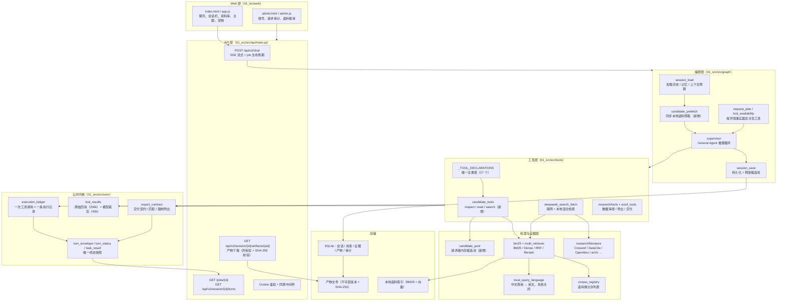
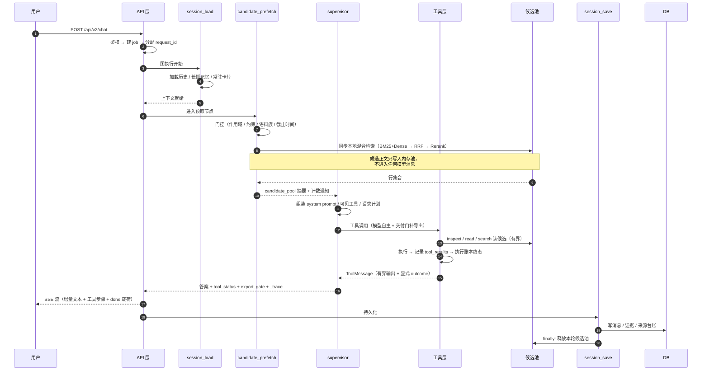
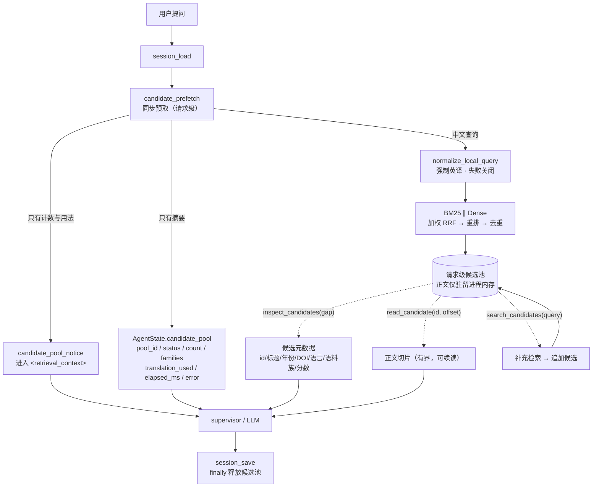
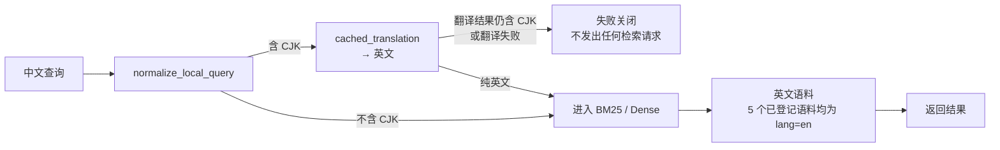

# CitrusSchalor 架构说明

产品名为 **CitrusSchalor**，仓库及内部标识保留 QAagent / CitrusQA。本文保留检索与原有单图执行架构说明；本轮新增的资源、科研快照、图件、任务和部署契约见 [产品演进契约](product_evolution.md)。

文档日期：2026-11-14
对应源码状态：本地分支 `feat/product-evolution`，基线 `e201c8c` 及尚未提交的工作区变更；源码能力、离线验证和服务器运行状态分别记录。

---

## 1. 范围与事实边界

### 1.1 系统是什么

QAagent 是一个面向科研任务的 Web AI 工作台，围绕 **提问 → 检索与阅读 → 证据核对 → 数据审查 → 图表和报告导出 → 文件管理** 组织能力。形态是**模块化单体 + 单 General Agent**，一个 FastAPI 进程、一个 Uvicorn worker、一张 LangGraph 主图、一份集中工具注册表。

### 1.2 本文承诺什么

本文描述源码职责与契约，不把源码存在等同于部署完成。当前验证结果与未验证边界由独立验收报告记录；真实 Apptainer、GPU 模型计算、恢复演练和服务更新分别验收。

### 1.3 明确的"没有"（重要）

| 方向 | 现状 | 说明 |
|---|---|---|
| 跨语言**文档**对齐 | **没有** | 系统只在**查询侧**把中文转成英文；不做跨语言向量对齐，不做同篇多语言版本合并，不做跨语言作者/题名匹配 |
| 候选池跨轮复用 | **没有** | 候选池是**请求级**的：进程内存、不落库、不跨轮复用，本轮结束即清理 |
| 候选池持久化 | **没有** | 不写 SQLite、不进会话历史、不进 SSE 载荷 |
| 联网结果的同步预取 | **没有** | 候选池只覆盖本地语料；联网检索仍由模型显式调用工具 |
| 第二个图执行器 / 消息队列 | **没有** | 全仓库只有一条主图 |

---

## 2. 分层架构



### 2.1 分层职责

- **Web 层**：单页应用。所有渲染由前端 reducer 消费 SSE 事件完成，服务端不返回"渲染好的 HTML"。
- **API 层**：会话与请求的唯一入口。鉴权、限流、取消、产物下载都在这一层。
- **编排层**：只有一个 LangGraph 主图。节点之间只通过 `AgentState`（TypedDict）交换数据。
- **工具层**：`_TOOL_DECLARATIONS` 是**唯一**工具注册表；工具可见性由 `Env` 事实决定，不由问题措辞决定。
- **检索与证据层**：本地检索、语料允许列表、查询语言门控、学术登记库检索。
- **公共内核**：执行账本、工具回执存储、终态归约、交付契约——所有"是否真的完成了"的判断都在这里。
- **存储层**：SQLite 保存会话与账本；产物文件不可变版本化。

---

## 3. 单轮请求时序

主图只有四个节点：

```text
session_load → candidate_prefetch → supervisor → session_save → END
```



### 3.1 终态只有一个来源

`TurnEnvelope`（`src/core/turn_envelope.py`）是 SSE、`/jobs/{id}` 和历史恢复共用的**唯一**终态快照：

- `display_status` ∈ `completed | partial | failed | cancelled`
- `execution_status`：工具执行事实
- `acceptance_status`：任务验收事实（要求的交付物是否真的产生且通过校验）
- `verified_artifacts` / `artifact_ids`：通过校验的产物身份

`derive_turn_status`（显示态）与 `build_task_result`（执行/验收）仍是权威归约器；`build_turn_envelope` 只做组合，**不从答案文字推断成功**。一个 `partial` 的显示态可以把 `completed` 的执行态降级，反之不行。

### 3.2 执行账本

`ExecutionLedger`（`src/core/execution_ledger.py`）为**每一次**工具调用写一条记录：`start` → `terminal`，带 `tool_call_id`、参数、状态、耗时、错误。账本通过 ContextVar 绑定，工具在 worker 线程里执行时仍能写入同一条记录（`src/tools/registry.py` 用 `contextvars.copy_context()` 复制上下文）。

---

## 4. 候选池：同步检索、不入上下文、按缺口补充

这是本系统在检索层最核心的机制：**用户提问触发的本地语料检索在模型看到问题之前就已经同步完成，但检索到的正文不进入模型上下文**。模型只有在**明确表达缺口**之后，才能通过有界工具把候选内容取进来。

### 4.1 数据流



### 4.2 硬边界（不可违反）

1. **预取正文不进入任何 LLM 消息。**
   `AgentState.candidate_pool` 是 TypedDict 里声明的键，只存元数据快照。LangGraph 会丢弃未声明的键，因此这个字段必须显式声明（见 `src/graph/state.py`）。
2. **只有工具调用能把候选内容带进上下文。**
   `inspect_candidates` 返回元数据 + 240 字摘录，`read_candidate` 返回一次 ≤6000 字符的切片，`search_candidates` 只返回新增候选的元数据。
3. **候选池是请求级的。**
   以 `pool_id` 为键存在进程内注册表；`session_save` 的 `finally` 块无条件释放，持久化失败也释放。TTL（默认 1800 秒）与容量（默认 64 个池）作为兜底。
4. **预取本身不是一次工具调用。**
   它不写 `tool_results`、不产生 ToolMessage、不进 `turn_trace`、不登记来源。证据只在模型真的调用候选工具时登记。
5. **失败必须诚实。**
   未执行 ≠ 没有资料。翻译失败、语料未加载、超时、零命中各有独立状态与各自的通知文本。

### 4.3 候选池状态机

`src/graph/candidate_prefetch.py` 定义的状态，以及各自**是否**向模型注入通知：

| 状态 | 含义 | 注入通知 | 模型可做什么 |
|---|---|---|---|
| `ready` | 预取成功且命中 | ✅ | `inspect_candidates` / `read_candidate` / `search_candidates` |
| `zero_hit` | 预取成功但没有命中 | ✅（说明"不等于语料没有资料"） | `search_candidates` 换关键词，或 `local_hybrid_search` |
| `translation_error` | 中文查询无法转成英文，**未发出**任何 BM25/Dense 请求 | ✅（明确禁止声称"检索过"） | 改用英文关键词调 `local_hybrid_search` |
| `corpus_unavailable` | 语料注册表读取失败，或目标语料族未加载/未授权 | ✅ | 显式 `local_hybrid_search` |
| `timeout` | 预取超出时间预算 | ✅ | 显式 `local_hybrid_search` |
| `error` | 预取过程异常 | ✅ | 显式 `local_hybrid_search` |
| `skipped` | 本轮不预取（用户要求不检索、只查网页、纯转换、数据审查、paper_only、时效性网页问题、复用历史证据、截止时间不足……） | ❌ | 走原有路由 |
| `disabled` | 部署关闭了 `CANDIDATE_PREFETCH_ENABLED` | ❌ | 走原有路由 |
| `no_matching_family` | 查询没有匹配到任何已登记语料族 | ❌ | 走原有路由 |

### 4.4 预取门控顺序

`prefetch_candidates` **永不抛异常**——任何失败都变成一个状态。命中以下任一条即提前返回：

1. `CANDIDATE_PREFETCH_ENABLED` 为假 → `disabled`
2. 查询为空 → `skipped(empty_query)`
3. `source_scope(query) == "web"` → `skipped(scope_web)`
4. `parse_request_constraints` 给出 `source_policy == "deny"` / `pure_transform` / `data_audit_only` → `skipped`
5. `resolve_tool_policy` 不允许检索，或只有 paper 附件 → `skipped`
6. `decide_retrieval` 的理由是 `no_retrieval_or_social` / `transformation_from_context` / `memory_write_only` / `recent_evidence_reuse` → `skipped`
7. 语料族为空且英文改写后仍为空 → `no_matching_family`（若英译失败则是 `translation_error`）
8. 路由判定为时效性网页问题（`mode == "web"` 且作用域不是 local/fusion、且理由不是 `explicit_search`）→ `skipped(time_sensitive_web)`
9. 剩余时间不足 `_final_reserve_sec() + 2` → `skipped(deadline_too_short)`

**关键点：不因 `mode == "none"` 跳过。** 只要语料族匹配，领域问题就会预取——这正是本机制与旧路由的区别。

### 4.5 三个候选工具的契约

| 工具 | 签名 | 输出上限 | 失败码 |
|---|---|---|---|
| `inspect_candidates` | `(gap="", limit=6, lang="", family="")` | ≤10 条；每条 ≤240 字摘录；**不含** `paper_id`/`chunk_id`/`record_key`；`main_results` 只有 `snippet`，**没有** `text` | `no_candidate_pool` / `no_candidates` |
| `read_candidate` | `(candidate_id, offset=0, max_chars=4000)` | `max_chars` 夹在 200..6000；正文包在 `<untrusted_local_evidence>` 里；结尾给出 `[继续读取: read_candidate(candidate_id="c01", offset=N)]` | `no_candidate_pool` / `candidate_not_found` / `candidate_offset_out_of_range` |
| `search_candidates` | `(query, limit=6)` | 只返回**新增**候选的元数据；已有候选 id 保持不变 | `candidate_query_empty` / `translation_failed` / `no_matching_corpus` / `candidate_search_failed` / `no_candidates` / `no_new_candidates` |

`gap` 只做**词面排序**（标题权重 3、摘要权重 1；英文按词、中文按 2-gram），同分保持预取顺序——**不在工具内新增模型调用**。

三个工具都声明 `requires=("local_corpus", "candidate_pool")`。没有候选池时它们根本不会出现在模型可见工具表里（`Env.candidate_pool` 为假），所以模型不会去调一个必然失败的工具。

### 4.6 候选池的工具元数据为什么不声明 `LOCAL_RETRIEVAL`

`tool_catalog.py` 里三个候选工具的 capabilities 只有 `{LOCAL_CORPUS}`，**没有** `LOCAL_RETRIEVAL` / `ROUTE_LOCAL`。原因：用户明确说"只查本地"时，完成门必须由 `local_hybrid_search` 满足。候选工具是**对预取结果的取用**，不是一次新的本地检索；如果把它们算作 `LOCAL_RETRIEVAL`，系统就会在没有真正检索的情况下宣布"本地检索已完成"。

### 4.7 并发与清理

- **绑定方式**：池对象在进程注册表里，只有 `pool_id` 穿过 `AgentState`。supervisor 从 `state["candidate_pool"]["pool_id"]` 取回并绑定到 ContextVar。
- **绑定是严格的**：拿不到 `pool_id` → 清空绑定；`pool_id` 查无此池 → 清空绑定。**绝不回退到某个可能过期的绑定**，避免跨请求串池。
- **线程可见性**：`src/tools/registry.py` 用 `contextvars.copy_context()` + `ctx.run` 执行工具，worker 线程继承请求上下文，因此能看到同一个池。
- **ContextVar 的边界**：在 `asyncio` task 里设置的 ContextVar **不会**传播回调用方。因此 supervisor 是从 `pool_id` 重新绑定，而不是依赖预取节点设置的绑定。
- **清理**：`session_save` 的 `finally` 块无条件释放；TTL 与 64 个池的容量上限作为兜底。

---

## 5. 跨语言检索路径

### 5.1 现状：查询侧翻译，不是文档侧对齐



- `src/retrieval/local_query_language.py`：**含 CJK 就必须翻译**；翻译失败或翻译后仍含 CJK → **失败关闭**（`LocalQueryLanguageError` / `translation_error`），绝不拿中文去搜英文库。
- **DOI 等稳定标识符会被保留**：翻译模型可能改写或丢掉 DOI，`normalize_local_query` 会把原文里的 DOI 追加回译文。
- 英文查询直接放行，不触发翻译。

### 5.2 语料语言事实（实测）

本仓库已登记的语料，其 chunk 的 `lang` 字段**全部**为 `en`。语料注册表（`01_src/src/retrieval/corpus_registry.default.json`）里有 **5 个语料、4 个语料族**：

| 语料（batch） | 所属语料族 | 显示名 | 语料内容语言 |
|---|---|---|---|
| `cqa_literature` | `literature` | 柑橘科研文献 | en |
| `cqa_translated` | `literature` | 柑橘科研文献（中文译本） | en（英文译文） |
| `cqa_methods` | `experiment_methods` | 柑橘实验方法 | en |
| `cqa_deng_book` | `deng_variety_book` | 中国柑橘品种志 | en（英文版） |
| `cqa_ucr_varieties` | `ucr_varieties` | UCR 柑橘品种记录 | en |

5 个语料的 `access_level` 均为 `public`（登录用户统一可用）。

因此**不存在跨语言文档对齐问题**：库里只有英文文本，不需要把中文文档映射到英文文档。中文品种书在**查询侧**翻译，翻译后检索英文版。

`src/retrieval/candidate_pool.py` 的 `_language()` 因此把已知批次一律映射为 `en`，未知批次**留空而不猜测**。

### 5.3 学术登记库检索（双语双查询）

`src/research/literature.py` 的 `search_literature` 与本地检索是两回事，它走的是外部登记库：

- 中文查询会做**一次**翻译，然后**原文 + 译文都查**（`for text in [t for t in (query, translated) if t]`），Crossref / OpenAlex / Europe PMC / PubMed / arXiv 并发查询。
- 去重键是 DOI → arXiv id → 规范化标题（`norm_title`）。
- 同一篇文献来自多个登记库时，保留高优先级来源，合并 `arxiv_id`/`doi`/`venue`，并把额外来源记进 `also_in`。
- `_annotate` 产出 `identifier_match` 与 `field_conflicts`：`title:<相似度>`、`title_variant:<相似度>`、`authors`、`year:<a>-><b>`。**冲突是冲突，不是"已核验"。**
- 登记库没查到 **不等于** 文献不存在（`notes` 里明确写这句）。

**没有**跨语言文档对齐、没有同篇多语言版本合并、没有跨语言作者/题名匹配。

---

## 6. 证据与执行账本

### 6.1 三个存储层

| 层 | 位置 | 用途 | 上限 |
|---|---|---|---|
| 原始回执 | `tool_results` 表 | 完整工具输出，SHA-256 摘要，可按 `tool_call_id` 回看 | `MAX_CHARS = 200_000`（超限保留首尾） |
| 模型裁剪 | `clamp_for_model` | 送进上下文前的裁剪 | `MODEL_MAX_CHARS = 40_000` |
| 本轮来源 | `session_evidence` | 本轮**被正文引用**的来源集合 | 每轮有限条目 |

### 6.2 来源登记

`turn_source_ledger.record_tool_sources` 读 `artifact["main_results"]` 与 `artifact["web_results"]`。因此：

- `inspect_candidates` / `search_candidates` 的 `main_results` 只有 `snippet`（模型实际看到的 240 字），**没有** `text`——证据库不会把"没读过的正文"记成"已读"。
- `read_candidate` 的 `main_results` 只放**这一次实际读到的切片**。
- **预取本身不登记来源**：它没有 ToolMessage，也不写 `tool_results`。

### 6.3 历史边界

- 候选工具的 `_safe_persisted_trace` 分支：保留 `_evidence_digest(rows)`（标题/DOI/摘录），**不保留**候选正文切片。
- HumanMessage 分支在持久化前剥离 `<retrieval_context>...</retrieval_context>`，所以下一轮不会看到上一轮的陈旧计数。

---

## 7. 交付契约与终态

### 7.1 交付契约

`src/graph/export_contract.py` 从用户请求里解析出**正向交付物**：

- `deliverable_contract(query)` → 每个需求带 `kinds`（`report_docx` / `report_html` / `table_file` / `bibliography` / …）和 `formats`（`docx` / `xlsx` / `csv` / …）。
- 输入文件的后缀、否定式子句、纯元数据子句（"标题：…"）都不产生交付物。
- **显式载体优先**：用户点名了可下载格式时，"清单""结论"这类裸名词是答案内容，不是额外文件；只有完全没点名格式时它们才留在需求里。

### 7.2 交付门

`artifact_matches_requirement` 只承认**已登记、属于当前会话所有者、磁盘存在、格式可识别、SHA-256 一致**的产物。`deliverable_match_map` 做二分图匹配——一个产物身份只能满足一个需求。

`forced_export_plan` 在模型没有自己导出、但用户明确要求了交付物时补一次导出，并记 `initiator`：`self_export` / `delivery_gate` / `mixed`。

### 7.3 终态

`TurnEnvelope` 是唯一终态快照，见 §3.1。回答里模型自己编的下载链接会被移除，不计为已验证产物。

---

## 8. 工具目录（27 个）

唯一注册表：`src/tools/__init__.py` 的 `_TOOL_DECLARATIONS`。
元数据：`src/core/tool_catalog.py` 的 `TOOL_METADATA`。
可见性：`src/graph/tool_availability.py` 的 `Env` / `available_tool_names` / `explain`。

| # | 工具名 | 类别 | 显示名 | requires | produces | 并发键 |
|---|---|---|---|---|---|---|
| 1 | `deepseek_search` | web | 网页搜索 | `network` | — | `deepseek_search` |
| 2 | `deepseek_fetch` | web | 读取网页 | `network` | — | `deepseek_fetch` |
| 3 | `deepseek_fetch_paper` | web | 获取论文全文 | `network` | — | `deepseek_fetch_paper` |
| 4 | `local_hybrid_search` | rag | 本地检索 | `local_corpus` | — | `local_hybrid_search` |
| 5 | `inspect_candidates` | rag | 查看候选 | `local_corpus`, `candidate_pool` | — | `candidate_pool` |
| 6 | `read_candidate` | rag | 读取候选原文 | `local_corpus`, `candidate_pool` | — | `candidate_pool` |
| 7 | `search_candidates` | rag | 补充候选检索 | `local_corpus`, `candidate_pool` | — | `candidate_pool` |
| 8 | `draw_svg` | analysis | 绘图 | — | `figure` | `draw_svg` |
| 9 | `read_account_file` | files | 读取账户文件 | `account_files` | — | `read_account_file` |
| 10 | `inspect_uploaded_table` | research | 读取表格 | `attachment`, `research_tools` | `research_data` | — |
| 11 | `audit_uploaded_data` | research | 数据审查 | `attachment`, `research_tools`, `session` | `annotation_table` | `research_data` |
| 12 | `search_literature` | web | 文献检索 | `network` | — | `literature_search` |
| 13 | `verify_uploaded_references` | research | 文献核验 | `research_tools`, `session` | `verification_sheet` | `research_references` |
| 14 | `fetch_and_audit_open_supplements` | research | 获取补充数据 | `network`, `research_tools`, `session` | `supplement_archive`, `supplement_report` | `research_web_fetch` |
| 15 | `word_document` | research | 处理 Word 文档 | `session`, `research_tools` | `report_docx` | `word_documents` |
| 16 | `export_table` | research | 导出表格 | `session`, `research_tools` | `table_file` | `research_artifacts` |
| 17 | `export_literature_evidence` | research | 导出文献证据 | `session`, `research_tools` | `bibliography` | `research_artifacts` |
| 18 | `export_paper_analysis` | research | 导出论文解读 | `session`, `research_tools` | `report_html` | `research_artifacts` |
| 19 | `export_experiment_design` | research | 导出实验方案 | `session`, `research_tools` | `report_html` | `research_artifacts` |
| 20 | `save_research_note` | research | 保存课题记录 | `session`, `research_tools` | `note` | `research_notes` |
| 21 | `recall_research_notes` | research | 查阅课题记录 | `research_tools` | — | `research_notes` |
| 22 | `export_research_notes` | research | 导出课题记录 | `session`, `research_tools` | `report_html` | `research_artifacts` |
| 23 | `export_corpus_gap_report` | research | 导出语料清单 | `session`, `research_tools` | `gap_csv` | `research_artifacts` |
| 24 | `analyze_research_data` | research | 科研统计 | `research_tools`, `session` | `statistics_report` | `research_statistics` |
| 25 | `audit_research_images` | research | 图像证据审查 | `account_files`, `research_tools`, `session` | `report_json` | `research_image_integrity` |
| 26 | `create_research_figure` | research | 创建科研图 | `research_tools`, `session` | `figure_package` | `research_artifacts` |
| 27 | `run_research_figure_script` | research | 执行绘图脚本 | `session`, `research_tools`, `script_sandbox` | `figure_package` | `research_artifacts` |

### 8.1 可见性规则

工具消失只有两种原因：

1. **声明的前置条件确实不成立**：没有附件、没有账户文件、没有会话、本地索引未就绪、没有候选池、运维关闭了科研工具。
2. **用户明说了**：只查本地 / 只查联网 / 这轮别检索。

**问题里出现"论文""基因""实验"这类词不会让任何工具消失，也不会让任何工具必须被调用。**

注册表当前含 27 个工具。可见数量随候选池、合法输入源、网络授权、科研功能和已验证的脚本 runner 改变；不再用一组固定数量代表所有部署。`available_tool_names` 与解释回执是唯一判定来源。

---

## 9. 不变量与失败语义

这些是代码里被测试固定下来的不变量。破坏任何一条，测试会失败。

| 不变量 | 含义 | 守在哪里 |
|---|---|---|
| 预取正文不入上下文 | 模型消息里只有计数通知，**没有任何候选标题或正文** | `test_candidate_prefetch.py` / `test_candidate_graph.py` |
| 只有工具能取候选 | `main_results` 在 inspect/search 中不带 `text`；read 只登记实际切片 | `test_candidate_tools.py` |
| 预取 fail-open | 任何门控或异常都变成状态，**永不抛出** | `test_candidate_prefetch.py` |
| 未执行 ≠ 没有资料 | 每种失败有独立状态码与独立通知文本 | `test_candidate_prefetch.py` / `test_outcome.py` |
| partial ≠ completed | 工具状态与任务验收分开计算 | `test_task_result` / `test_turn_status` |
| 候选池请求级 | `session_save` 结束即释放；不落库、不跨轮 | `test_candidate_graph.py` |
| 工具输出有界 | 候选工具自己限制条数与字符数，全局裁剪再兜底 | `test_candidate_tools.py` / `test_tool_result_clamp.py` |
| 产物必须可校验 | 只有登记 + 所有权 + 磁盘 + 格式 + SHA-256 全过才算产物 | `test_deliverable_check.py` / `test_artifact_lifecycle.py` |
| 一个请求一条账本 | 每次工具调用都有 start/terminal 记录 | `test_execution_ledger.py` |
| 死代码不复活 | 已确认无引用的符号不能回来 | `test_dead_code_removed.py` |

---

## 10. 代码地图与验证命令

### 10.1 代码地图

| 关注点 | 文件 |
|---|---|
| 主图与 supervisor | `01_src/src/graph/general_agent_graph.py` |
| 候选池数据层 | `01_src/src/retrieval/candidate_pool.py` |
| 同步预取节点 | `01_src/src/graph/candidate_prefetch.py` |
| 三个候选工具 | `01_src/src/tools/candidate_tools.py` |
| 工具注册表 | `01_src/src/tools/__init__.py` |
| 工具元数据 | `01_src/src/core/tool_catalog.py` |
| 工具可见性 | `01_src/src/graph/tool_availability.py` |
| 请求计划 | `01_src/src/graph/request_plan.py` |
| 图状态契约 | `01_src/src/graph/state.py` |
| 会话加载/保存 | `01_src/src/graph/session_nodes.py` / `session_persistence.py` |
| 本地混合检索 | `01_src/src/tools/deepseek_search_fetch.py` |
| 查询语言门控 | `01_src/src/retrieval/local_query_language.py` |
| 语料注册表 | `01_src/src/retrieval/corpus_registry.py` |
| 学术登记库检索 | `01_src/src/research/literature.py` |
| 执行账本 | `01_src/src/core/execution_ledger.py` |
| 工具回执存储 | `01_src/src/core/tool_results.py` |
| 来源台账 | `01_src/src/core/turn_source_ledger.py` |
| 终态归约 | `01_src/src/core/turn_status.py` / `task_result.py` / `turn_envelope.py` |
| 交付契约 | `01_src/src/graph/export_contract.py` |
| API 与 SSE | `01_src/src/api/main.py` |
| 上下文注入 | `01_src/src/core/context_manager.py` |

### 10.2 验证命令

从仓库根目录运行：

```bash
# 全部离线检查（三组独立进程，无模型请求、无网络、无真实科研数据）
python -X utf8 engineering/word_delivery_20261112/run_checks.py
```

针对性运行：

```bash
PYTHONPATH=01_src python -m pytest -q \
  01_src/src/retrieval/test_candidate_pool.py \
  01_src/src/tools/test_candidate_tools.py \
  01_src/src/graph/test_candidate_prefetch.py \
  01_src/src/graph/test_candidate_graph.py \
  01_src/src/graph/test_tool_visibility.py \
  01_src/src/graph/test_tool_bindings.py \
  01_src/src/graph/test_request_plan.py \
  01_src/src/core/test_dead_code_removed.py
```

查看当前注册的真实工具表：

```bash
PYTHONPATH=01_src python -X utf8 -c "
from src.tools import _TOOL_DECLARATIONS
from src.core.tool_catalog import TOOL_METADATA
for d in _TOOL_DECLARATIONS:
    name = d[0].name
    md = TOOL_METADATA.get(name)
    print(name, '|', getattr(md, 'display_label', ''), '|', d[4])
"
```

### 10.3 生效方式

源码改动需要**受控重启**服务后才会在运行实例中生效。本仓库的离线检查不重启服务，也不验证运行实例的内存版本。
