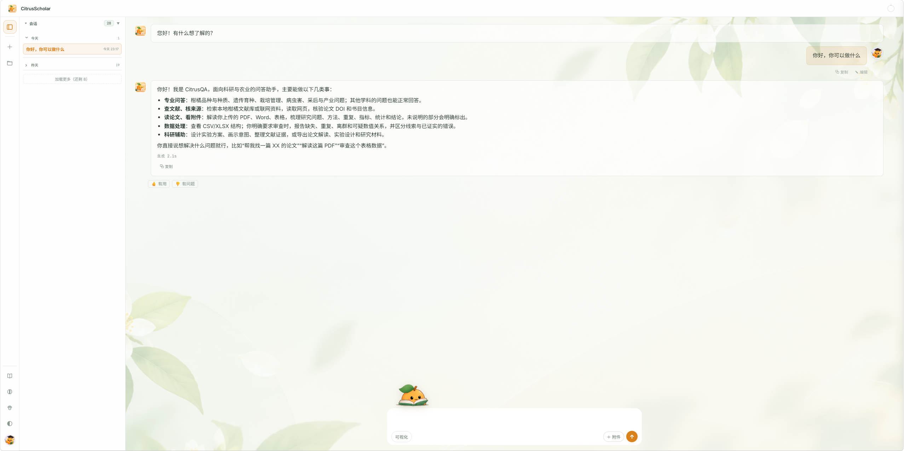

# CitrusScholar 用户指南

> 本指南适用于 QAagent 当前 Web 工作台。产品界面使用 **CitrusScholar**，技术文件和部分路径沿用 **CitrusQA** 名称。

## 1. 第一次登录：界面在哪里

登录后，工作台由左侧会话栏、聊天主区、上下文圆形入口、右侧轮次导航与可打开的资料库组成。你不需要记住具体工具名，只需说明任务和期望结果。

*图 1：登录后的工作台。实际界面会随账号、窗口宽度和已开启的面板变化；助手回答里可能仍自称 CitrusQA，这是同一 CitrusScholar 服务的内部技术名称。*

| 位置 | 按钮或区域 | 用途 |
|---|---|---|
| 左侧会话栏 | **会话**、`＋`、今天/昨天分组、**加载更多** | 新建、切换和续聊；较早记录按需加载 |
| 左侧底部快捷栏 | **使用指南**（书本）、**账号记忆**、**宠物**（爪印）、**主题** | 打开六页引导；查看跨会话记忆；调整小橘；切换三套主题 |
| 左上角品牌 | **CitrusScholar** | 当前产品界面名称 |
| 右上角圆形入口 | **上下文概览** | 查看当前会话的公开上下文状态，不是隐藏推理或账号记忆 |
| 聊天主区 | 用户问题、助手回答、工具执行轨迹、复制与反馈 | 提问、查看来源和展开执行过程 |
| 悬浮小橘 | 输入区上方/附近的柑橘伙伴 | 拖动、点击互动；宠物状态不代表真实工具进度 |
| 输入区 | **可视化**、**＋附件**、发送/停止按钮 | 开启 SVG 图示、添加文件并发起科研任务 |
| 右侧可展开区域 | 轮次导航、**资料库** | 定位真实用户提问；预览、引用和下载本账号文件 |

第一次进入时，可以直接输入 **“你好，你可以做什么？”**。系统会给出当前能力概览；要得到可直接执行的结果，再按下一节写清研究对象、证据范围、操作和期望产物。

## 2. 提问时说清四件事

推荐写清楚：**研究对象 / 证据范围 / 要执行的操作 / 希望获得的结果**。

- “比较 2021 年以来柑橘黄龙病早期检测的 PCR 与图像识别研究，给出证据来源和局限。”
- “**仅用本地文献**寻找 RWP-RK 功能证据，不能证实的内容单独说明。”
- “核验我上传的参考文献，检查 DOI、标题、作者和年份。”
- “解释附件论文的研究问题、方法、统计与结论。”
- “设计一套耐盐胁迫实验，列处理、对照、重复和可能混杂因素。”

普通问题不一定触发工具。明确要求“只用联网/本地”“核验 DOI”“生成文件”会帮助系统选择合适能力。

## 3. 文献检索和本地原文阅读

**联网检索**：Web Search 找网页和文献，必要时 Web Fetch 或论文获取工具读取正文；可能受网络、开放获取状态和服务限制。

**本地检索**：查询服务器已安装的授权语料，包括论文及按部署启用的品种、实验方法等资料；不等于自动检索整个互联网。

**文献核验**：针对 DOI、标题、作者、期刊和年份进行登记元数据比对；没有查到不等于论文不存在。

### 如何打开本地原文

回答中可识别的本地来源标识，或回答下方的本轮来源入口，点击后打开**本地语料阅读器**，你可以：

1. 阅读已返回的 Markdown 文本。
2. 切换「原始 Markdown」查看原始文本形式。
3. 点击「复制原文」。
4. 原文存在可识别 DOI 时，跳转出版方解析链接。

**不要求 DOI 才能打开本地原文**。系统可能依据正式语料保存的分块顺序重建阅读文本，并不保证与出版 PDF 逐字版式相同，也不承诺每个引用能精确跳到对应句子。权限不足或来源不可用时应显示提示。

UCR、中国品种资料不强制有 DOI；私有实验方法受登录账号和原有授权控制。

## 4. 上传、预览和资料库

支持按界面实际允许的图片、PDF、Word、表格等文件。**上传文件本身不会自动运行数据审查**；请在问题里说明你需要的是解读、摘录、核验还是审查。

右侧**资料库**分为「上传资料」与「生成成果」。文件卡片可以预览、用「＋」加入当前会话、下载原件；有来源关联的生成文件可以定位到原会话。生成 SVG 支持安全图片预览、下载和复制 SVG 源码。

鼠标靠近资料库左边缘可调整宽度，变宽后文件卡片按容器宽度自动增加列数。双击分隔线可以恢复默认宽度。重要科研成果及时下载；界面当前提示账号资料库按 **30 天未活动**规则保留，具体以服务端实际规则为准。

## 5. 审查实验数据：下载标注 Excel

上传工作簿后明确提出：

> 帮我审查这份 qPCR Excel，重点检查重复行、必填缺失、组内异常值和逻辑冲突。保留原始数据，输出一份标注 Excel，并说明每条信号需要怎样人工复核。

系统先检查表头/字段，再运行适用的确定性数据规则。当前默认生成 **`原文件名_数据审查.xlsx`**，并非旧版 HTML-only 报告。结果一般包含：

- **原数据表**：有问题的位置以浅红填充、红色边框和批注标记，不直接覆盖原始值；
- **问题清单**：工作表、单元格、异常类型、原值、规则和建议；
- **审查概览**：检测范围、问题分类与未覆盖信息。

一个原文件的多个工作表可以汇总在同一标注文件中。规则包括适用条件下的缺失、非数值、重复行/键、组内探索性 IQR 离群、上下界和逻辑冲突等。小样本、单位、共享对照、公式和实验设计会影响解释，**异常提示不是错误判定，更不是造假鉴定**。某张表无法读取时，检查未覆盖提示。

[数据审查的详细口径](research_data_audit.md)。

## 6. 生成科研文件和图示

- **文献证据**：按工具支持导出 XLSX / RIS / BibTeX。
- **论文解读、实验设计**：可根据任务整理为相应报告，实际文件格式由工具决定。
- **可视化**：开启输入区的「可视化」，请求流程图、机制示意或实验设计图；生成 SVG 可在资料库下载或复制源代码。
- **课题记录**：明确要求“保存/回顾课题记录”，与自动账号记忆分开。

生成失败和不完整状态会如实提示，不会把未完成产物伪装为可交付结果。

## 7. 上下文、记忆和历史不是同一个功能

**会话历史**保留用户对话与生成文件的关联；右侧轮次导航用于定位真实提问，工具事件不是新的问题。

**上下文概览**从独立圆形入口打开，用于查看当前会话相关的上下文状态。模型不保证每轮输入都包含完整历史，这个入口也不是“查看隐藏推理”。

**账号记忆**从左侧快捷栏打开，显示账户已保存的偏好或长期事实，可能跨会话使用但不意味着每句话都被保存。可清空账号记忆；清空记忆不会同步删除会话历史。明确保存的课题记录是另一项功能。

## 8. 小橘宠物与三套主题

通过**宠物（爪印）**入口，你可以调整：显示/隐藏、大小（80%–180%）、恢复位置、宠物动画、活跃程度（安静 / 自然 / 活泼）。宠物可以拖动到喜欢的位置、点击互动；待机时从已有动作中自主活动，进行检索、写作等任务时优先使用任务动作。宠物是界面陪伴，并不表示真实工具进度。

通过**主题**入口选择：**春日花笺 / 午后书房 / 夜林花语**。全局「减少动画」会让部分动态效果保持静止。

处理中可能出现绿色小芽与橙色文字 **“小橘正在回答您的问题...”**。工具执行区“已完成”只表示相应步骤结束，不等于整轮回答已经结束。

## 9. 常见工具怎么用

| 目标 | 典型工具能力 | 可直接说 |
|---|---|---|
| 查近期文献 | Web Search / Web Fetch / 论文 Fetch | “找公开论文，注明 DOI 和来源” |
| 查既有证据 | 本地混合检索 | “只使用本地语料，列出来源” |
| 查柑橘品种 | 已安装的品种语料 | “比较两个品种，说明出处” |
| 读论文 | PDF/Word/附件阅读 | “说明论文的材料、方法、结果和局限” |
| 核验参考文献 | DOI 与元数据核验 | “检查这些 DOI 是否与标题作者对应” |
| 审查数据 | 表格概览 + 数据审查 | “生成单元格标注的 Excel” |
| 画示意图 | SVG 绘图 | “画实验流程 SVG 并提供文件” |
| 保存课题要点 | 课题记录工具 | “把这些要点保存到课题记录” |

## 10. 管理员与安全说明

普通账号拥有各自的会话、资料库和记忆。模型或联网检索服务可能接收任务所必需的部分内容，请不要上传不适合外传的敏感资料。

管理员通过 `/admin` 使用账号、审计、服务配置及**文献候审库**等管理功能。候审库仅保存抓取到的原始资料与用户明确授权的上传文件，供人工判断保留或拒绝；**不会自动切块、向量化、激活正式语料**。普通用户不能仅凭来源 ID 读取未经授权的实验室资料。

## 11. 常见问题

**上传 Excel 为什么没有自动审查？** 上传只表示可在当前请求使用，还需明确提出“审查数据”。

**文献没有 DOI 能打开吗？** 如有可解析的本地来源且账号有权限，可以打开；DOI 不是必要条件。

**为什么阅读器的全文和出版社 PDF 排版不同？** 当前阅读文本可能由语料分块顺序恢复，不能保证原始版式或精确段落锚点。

**为什么同一个文件在另一个会话还能用？** 资料库按账号管理文件，可使用「＋」加入新会话。

**“已完成”是不是模型已经回答完？** 不一定，可能只是某项工具完成。

**清空记忆会删除历史对话吗？** 不会，二者分别管理。

**为什么有的功能暂时不可用？** 模型能力、网络、文件格式、权限和服务配置均可能限制本次任务。请查看工具执行状态。

---

源码介绍见 [README](../../README.md)；Linux 部署步骤见 [部署文档](deploy_linux.md)。
