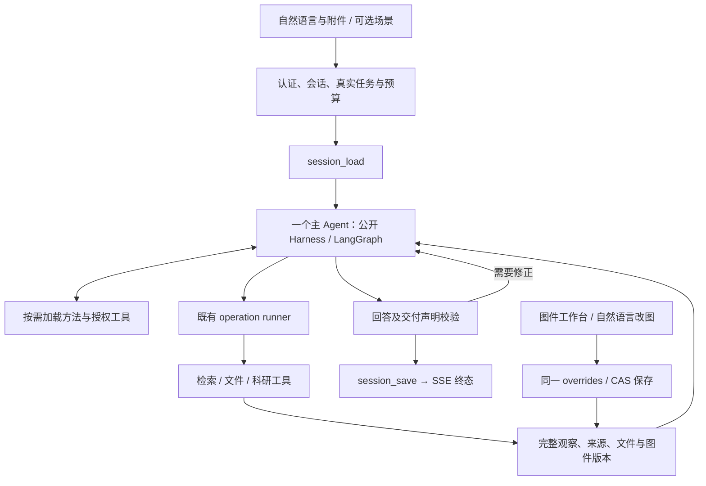

# CitrusScholar · 科研智能体工作台

> 产品名为 **CitrusScholar**，GitHub 仓库保留 [`w1-23/QAagent`](https://github.com/w1-23/QAagent)。既有数据库、环境名和存储键不随品牌变更迁移。

CitrusScholar 以一个 General Agent 为主体，根据自然语言目标选择工具、阅读结果并继续处理。领域资料 RAG 和科研预设提供专业方法与可核验的执行结果；它们不接管主循环，也不要求先识别场景才能使用通用检索、文件和编码能力。实际可用能力受账号权限、服务配置和运行环境约束。

## 四个预设场景

| 场景 | 用途 | 结果与边界 |
|---|---|---|
| 科研检索 | 在获授权的本地资料和网络中发现、阅读、比较证据 | 给出实际读取的来源；未查到、网络失败与未执行分别说明 |
| 文献核验 | 查找文献记录，核对提交的书目字段 | 存在性与字段准确性分开；同一审查跨批续查并全量导出，解析范围与未核条目明确保留 |
| 数据审查 | 检查授权表格的缺失、重复、范围、分组及数值关系 | 保留原始位置、范围与限制；异常信号不是学术不端结论 |
| 科研绘图 | 读取和整理数据，以 Python 和固定 Nature 方法生成真实图件 | 分开记录数据/分析、生成、审核、保存和导出事实 |

**自然语言是主入口。** “＋”提供附件和这四个场景的可选选择；不选择也能由 Agent 自主发现方法。Nature 规范、统计方法及 Word 等文档交付属于内部可组合方法，不是额外场景。Skill 是方法资源，工具是受权限和操作账本控制的动作；读取方法不等于执行成功。

**图片编辑属于图件工作台 `/figures`。** 用户可以在画布/对象树编辑，也可以用自然语言要求修改已有图件。两者使用同一项目、语义 overrides、版本冲突检查和保存机制，不各自维护一套图片状态。工作台不是任意 SVG 或通用照片编辑器。

## 当前实现与验证状态

2026-11-15，P5–P7 源码接线和本轮 P8 收敛、必要回归已完成，运行实例尚未切换。相关 Python 组合回归与修复后定向复测、前端契约检查均有记录；真实服务实测和部署另行确认。不能用当前源码说明替代已部署版本证明。

- **P3**：生产源码接入公开 LangChain `create_agent` 和 LangGraph 持久运行器。逐模型/工具步保存加密检查点，保留真实身份、预算、取消、操作账本与完整结果。未知副作用先对账，恢复不刷新预算。
- **P4**：版本化会话文本文件、按需方法加载及“＋”显式选择已接通。真实供应商验证过自然语言加载和跨轮文件修改。正常主图不再执行隐式候选预取；完整 GPU/RAG 双来源联合检索尚未验收。
- **P5**：冻结分析、独立渲染、当前保存和工作台语义编辑已接线；图件历史、历史下载与恢复接口已移除，只保留原始脚本、必要冻结数据、当前 overrides/manifest 与当前导出。隔离真实容器此前验证过生成、样式保存与数据摘要不变；取消历史后的当前保存、CAS、冻结数据与前端契约已通过必要回归，真实服务仍待用户实测；合成数据验证不等于真实科研任务验收。
- **通用 execute**：仍有既有审批阻塞，不能声称已经具备完整通用命令工作区。现有科研 Python worker 是独立的受控能力。
- **P6**：数值审查补充真实逐规则执行回执、精度与配置校验、独立注释层、可选数值模式与显式实验结构，补充材料共用有界解析器。执行范围和限制以实际回执为准，不将规律信号解释为不端结论。
- **P7**：聊天与 PDF 面板共用持久 `ReferenceAudit`；保留原始条目与重复/无 DOI，逐字段核验，取消后沿同一 audit_id 继续，全量导出 JSON/XLSX/RIS/BibTeX。启发式文献提取仍为 partial，未配置 GROBID/OCR。
- **P8**：完成本轮源码收敛、无引用旧路径清理、必要契约与相关回归；运行服务由用户另行启动实测。源码、离线回归与部署状态分别记录，未将既有通用 execute 阻塞记为通过。

[迁移证据与未验证范围](01_src/docs/agent_migration_evidence.md) · [General Agent 架构契约](01_src/docs/general_agent_architecture.md) · [上下文生命周期](01_src/docs/context_lifecycle.md) · [上游来源与许可证](01_src/docs/agent_loop_sources.md)

## 一个主循环与四类状态



原始对话历史、模型实际发送视图、任务执行检查点、资产与证据分别保存。活动上下文可在原文已可靠留存后生成导航摘要；摘要不替代数值、引文或授权。原文和完整工具结果可按身份与引用精确回读。取消、超时、存储失败和部分完成会明确保留，`done` 不保证 `history_saved=true`。

检索由 Agent 按目标和观察选择。在需要新事实且两种来源均获授权时，小批发现本地与网络候选，再按证据质量精读和补搜。用户的仅本地、仅网络、不联网、不检索要求优先；寒暄、改写、纯转换及仅审上传材料不机械检索。查询侧英译、来源权限和失败状态由既有适配器保留。

## 开放绘图与统一编辑

绘图生成不限于几个声明式模板。已有受限声明式工具可处理常见图；隔离 Python worker 可使用实际安装的 Matplotlib、Seaborn 和科学计算依赖，生成更复杂的图和组合图。分析、统计标注与数值必须来自真实运行或可验证的结果引用，不能以相似外观冒充分析。

初次科研图使用固定 **nature-figure 2.8.0 / `7bff1d0539c0dfad6c30178bb93ce6dd8a5cebf8`**，记录实际布局、PDF 字号、碰撞等检查及 PDF 摘要。审核未执行、失败和不支持项如实说明；这不是 Nature 官方认证，也不能证明研究结论。

P5 的脚本契约把分析与渲染分开：分析保存 typed 中间表，独立 `render_script` 只读取冻结结果；样式重绘不传入原始分析脚本或原始数据文件。宿主核对数据、渲染代码与支持的数值几何摘要，漂移时拒绝保存。旧混写脚本和无法证明几何一致性的图仍可保留及下载，但不能默默重算后声称只改样式。

工作台按 manifest 公布有限语义对象：文字、坐标轴边框、数据线、散点/marker、柱填充/边框、误差棒、图例、网格和色条。支持范围以真实对象为准，不支持拾取不等于禁止生成该图型。颜色、字号等后续用户审美不重新受初版 Nature 美学限制；旧审核只认证旧字节。

正式保存替换当前图件并固定其依赖，不保留可浏览或恢复的历史版本；内部 `render_version`/CAS 只用于拒绝并发覆盖。预览草稿与已保存图件分开，下载返回当前保存的真实字节；PNG/PDF/SVG/TIFF 是否存在以项目当前导出记录为准。Origin、完整 R 后端、电子表格编辑器与任意 SVG 编辑器不作为第一阶段依赖。

## Web 与账号

- 聊天区保留真实执行轨迹、历史轮次和上下文入口；工具调用不会变成新的用户轮，私有模型推理不进入公开记录。
- 资料库区分上传材料与生成成果，按账号控制预览、引用、下载和来源定位；附件加入会话不等于进入共享科研语料。
- 图件工作台查看、修改和保存同一项目；未保存草稿不会覆盖当前下载。辅助网格和毫米标尺默认开启，可随时关闭，仅用于编辑定位。资料库导入将变量与单位成组展示，窄屏可滚动操作。
- 左侧保留会话、偏好与研究记录、宠物和主题。长期科研笔记按明确授权保存。
- `/admin` 仅供管理员管理账号、配置、审计和文献候审库。候审文件不会自动进入正式检索语料。

病害图片分析仅用于辅助筛查，不是确诊。模型回答与数据异常需研究者复核。材料可能发送给配置的模型服务，上传范围应符合用户自己的数据要求。

## 本地启动与 Linux 部署

Windows 本机使用 Windows 主服务、WSL Linux 和 Docker；远程 Linux 可直接部署 Linux 服务和受控 worker，不照搬 Windows 路径。完整启动默认使用 GPU，管理员保留 CPU/GPU 切换能力。Python 验证环境名 `CitrusSchalor` 是历史标识，与产品名不同。

在仓库根目录按 [本地启动说明](01_src/docs/local_startup.md) 运行：

```bash
E:/anaconda/python.exe -B -X utf8 01_src/scripts/local_startup.py
```

默认服务地址为 `http://127.0.0.1:8010`，实际以启动回执为准。服务健康、检索、worker 与真实图件导出需分别验证。源码修改不自动重启现有实例；部署前核对源码版本、worker 镜像标识与前端资源版本。

[Linux 部署指南](01_src/docs/deploy_linux.md) · [用户指南](01_src/docs/user_guide.md) · [完整架构说明](01_src/docs/architecture.md) · [科研工作区方案](01_src/docs/research_workspace_plan.md) · [数据审查说明](01_src/docs/research_data_audit.md)

## 源码与验证

产品实现主要位于 `01_src/src/`：`agent` 为 Harness 适配，`graph` 为会话外壳，`research` 为科研服务，`figures` 为图件/隔离渲染与版本，`api` 为接口，`session/core` 为身份、任务及持久资产。`01_src/web/` 为界面，`01_src/docs/` 为产品说明。

仓库只纳入 QAagent/CitrusScholar 本体所需源码、依赖、测试和文档；秘密、真实账号数据、模型权重、运行缓存、临时验证材料及无关实验不入库。测试应使用隔离临时存储；离线契约、真实供应商、真实容器、浏览器和部署验证分别报告，不把单层通过扩大成整套产品验收。
