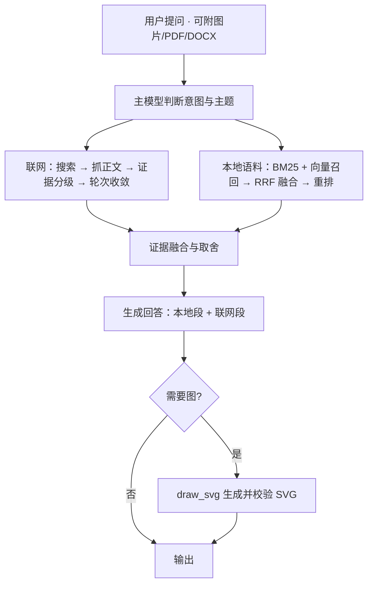

# QAagent

> 一个「**联网优先、语料补充**」的柑橘与农业问答智能体：先查外面的公开资料，再用本地文献补细节；能看图、读 PDF，也能把答案画成图。

**本仓库只包含代码，不包含语料库、模型权重、运行数据和任何 API Key。**

- **联网优先**：先判断问题是否需要外部事实，需要就搜索 + 抓正文，按轮次收敛
- **本地语料补充**：BM25 + 稠密向量 + RRF 融合 + 跨语种重排，只补充、不主导
- **多模态输入**：图片 / PDF（含扫描版）/ Word
- **可视化输出**：需要时才画，输出经校验的自包含 SVG

---

## 1. 为什么是「联网优先 + 语料补充」

柑橘领域的信息有一半在更新：品种登记、农药标签与残留限量、检疫规定、市场价格，本地文献库很难跟上。反过来，公开网页质量参差，直接当证据用会污染结论。

所以这里的取舍是：

1. 主模型先判断问题类型，决定这一问该走哪条路；
2. 需要时效或外部事实时，**先联网**，再把本地语料当补充；
3. 两类证据**分开成段**输出：本地段标文献编号，联网段标链接；谁也冒充不了谁。

一句口号：**置信性优先（confidence-first）**——宁可说"本地语料未覆盖"，也不编一条出处。

## 2. 一次问答的处理链路



## 3. 本地语料是怎么补充进来的

### 3.1 语料库不随仓库分发

`agent/` 是运行期数据根（语料、向量库、会话、工作区都在里面），已在 `.gitignore` 中忽略，只保留一个 `.gitkeep` 占位。仓库里没有任何文献包、索引或模型权重。

### 3.2 语料按类别组织

文献按主题分桶（品种砧木、病虫害与防治、栽培生理、采后贮运、农残与标准等），类别作为块的元数据随语料一起入库；检索前按类别过滤（`_local_category_allowed`），避免"什么都能搜到、什么都搜不准"。

### 3.3 本地一侧的检索链路

```
中文问题
  └─ 本地检索强制英文查询：术语规范化 / 结构化假想答案（中文问题 → 英文检索式）
      ├─ BM25 关键词召回（top 40）─┐
      └─ 稠密向量召回（top 40）───┤  multilingual-e5-large (1024 维)
                                  └─ RRF 融合（k=60）→ 候选 20 → bge-reranker-v2-m3 重排
                                      └─ 动态阈值（0.25 起，top×0.6）→ 保留 10 条 → 进上下文
```

片段带稳定的文献编号，编号可回溯到原文，也用于引用校验。所有阈值都在 `02_配置_config/config.yaml` 的 `retrieval` 段里，可直接调。

### 3.4 补充规则：只补充，不主导

- 只有问题主题与某类语料匹配时才检索，不匹配就不硬塞；
- 与联网证据重复时只保留一处，本地片段必须标明"本地来源"；
- 证据不足直接说"本地语料未覆盖"，不用模型记忆补位。

### 3.5 接入自己的语料（4 步）

```powershell
# 1) 导入：PDF / txt / md → 分块（默认 800 字符，按段落聚合）+ 向量
python 04_脚本_scripts\ingest.py --dir "D:\我的文献" --batch mycorpus

# 2) 建/重建向量表：复用批次自带向量，只补缺口块（分钟级）
python 04_脚本_scripts\reindex_lance.py --batch mycorpus

# 3) 重启服务（索引在启动时加载）
.\run.ps1

# 4) 端到端验一条：起服务后逐条提问，核对答案与引用
python 04_脚本_scripts\e2e_check.py --query "柑橘黄龙病的传播途径有哪些"
```

几个约定：

| 项 | 说明 |
|---|---|
| 默认输入目录 | `agent/data/import/`（也可 `--dir` 指定） |
| 批次名 | 就是索引名，`--batch` 不填时用输入目录名；多批次可并存 |
| 产物 | `ingest.py` → `chunks.jsonl` + `qdrant_data/`；`reindex_lance.py` → `lancedb/<batch>.lance` |
| 向量维度 | 1024（`intfloat/multilingual-e5-large`），表结构固定，勿手改 |
| 重排模型损坏时 | `reindex_lance.py --batch <name> --no-qdrant` 强制整体重嵌入 |

## 4. 联网优先是怎么落地的

0. **按次开关**：前端输入框旁有联网开关，随请求下发；关掉就只走本地语料。
1. **先判**：主模型判断这一问是否需要时效/外部事实；不需要，一次本地回答就结束。
2. **再查**：搜索 → 选页抓正文（不整站爬）→ 快模型判相关性 → 轮次收敛（`config.yaml` 的 `web_agent.max_rounds`，默认 2，代码侧再钳到 ≤2；第 1 轮证据就够则提前停）。
3. **再分级**：网页原文链接优先；本地片段必须标本地来源；两段式输出，避免把网络内容"洗"成本地结论。
4. **失败要说**：搜索/抓取失败就明说没查到，不假装查过。

## 5. 多模态输入

| 输入 | 处理方式 | 限制 |
|---|---|---|
| 图片 `jpg/png/webp/gif` | magic bytes 校验后转 data URL，直接给视觉模型 | 单次 ≤8 张，合计 ≤20MB |
| PDF | PyMuPDF 抽文本 | ≤200 页 |
| 扫描版 PDF | 文本过少时渲染前 5 页为图片，走视觉输入 | 页数固定截断，避免超限 |
| Word `docx` | 读 `word/document.xml` 抽段落文本 | 解压后 ≤100MB |

附件只在请求内存里处理，**不写盘、不进知识库**：图片里的内容不会被检索到，只会参与当次回答。

## 6. 可视化输出

- 请求带 `visualization_enabled` 时才挂 `draw_svg` 工具（默认关闭，省一次模型调用）；
- 只在"图能把关系讲清楚"时画，简单问答不出图；
- 图里的数字只能来自当前答案或证据，示例必须标"示意"，不许编数；
- 输出前做 SVG 清洗与校验，最终以代码块形式嵌入回答。

## 7. 代码结构

```
01_源码_src/
  src/                 FastAPI 服务 + 检索 + 图编排 + 工具 + 提示词
    api/ core/ engine/ enhance/ graph/ guardrails/ prompts/ retrieval/ session/ skills/ tools/
  web/                 无构建步骤的前端（index.html + app.css + app.js）
02_配置_config/        config.yaml、.env.example、enhance.yaml.example、MODEL_ROUTING.md
04_脚本_scripts/       ingest.py、reindex_lance.py、prepare_models.py、e2e_check.py
agent/                 运行期目录：data/ state/ workspace/ .env（首次启动自动创建，不入库）
run.ps1 / stop.ps1     一键启停
```

运行期路径是写死的约定：`src/config.py` 把 `agent/` 当数据根、把 `02_配置_config/` 当配置根，`run.ps1` 也按这个布局找入口。**移动或改名这几个目录会导致起不来。**

## 8. 本地运行

```powershell
# 1) 配置密钥
Copy-Item 02_配置_config\.env.example 02_配置_config\.env
#    填 DEEPSEEK_API_KEY（对话）、SERPER_API_KEY 或 WEB_SEARCH_API_KEY（联网）等

# 2) 一键启动：首次会建 rag-agent 环境、装依赖、预下载向量/重排模型
.\run.ps1

# 3) 打开 http://127.0.0.1:8000
```

已有 Python 3.10–3.12 环境时，也可以手动来：

```powershell
python -m venv rag-agent
.\rag-agent\Scripts\python.exe -m pip install -r requirements.txt
python 04_脚本_scripts\prepare_models.py --skip-reranker   # 只下向量模型，跳过 1–2GB 的重排模型
```

模型默认走 HuggingFace 国内镜像（`HF_ENDPOINT=https://hf-mirror.com`，见 `04_脚本_scripts/prepare_models.py`），缓存落在 `agent/.hf_cache/`。

## 9. 数据边界与许可

- 语料、向量索引、会话数据、日志、`.env` 与模型缓存均不入库；
- 语料涉及第三方版权，请使用你有权使用的文献；本仓库不带任何文献包；
- 许可：见 [LICENSE](LICENSE)（MIT）。
